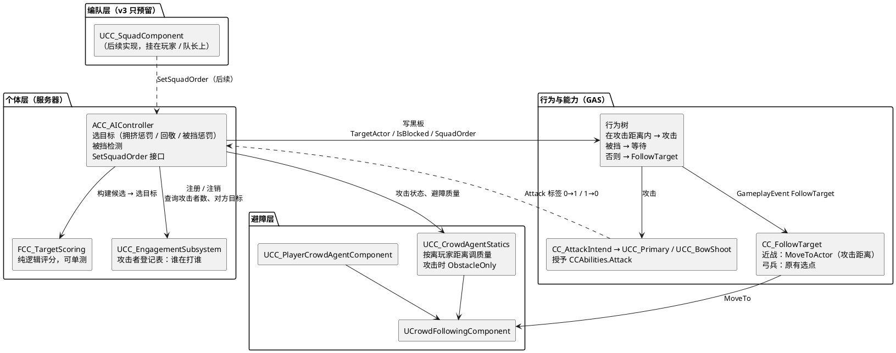
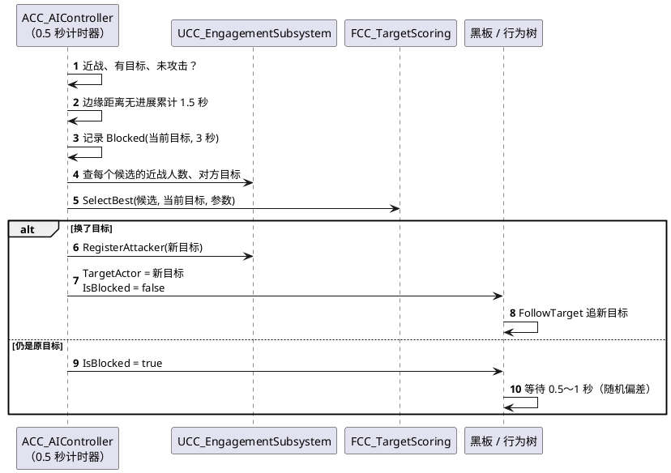

# 群体战斗 AI 设计 v3（骑砍式三层：个体自由交战 + 编队接口预留）

> 状态：**已实现**（2026-10-20，`Gameplay` 分支，待本地编译与编辑器验证）。取代 v2.1 的 `Docs/AI-Engagement.zh-CN.md`（槽位 + 令牌）与 `Docs/AI-Engagement-Usage.zh-CN.md`。接入步骤见第 10 节。
> 目标规模：同屏 100～150 只小怪 + 若干随从 + 玩家，多对多混战。
> 图均为 PlantUML，可直接粘贴到语雀「文本绘图 → PlantUML」。

## 0. 为什么改

v2.1 是动作游戏的「围攻玩家」方案：每个被围攻的目标建三圈槽位，用令牌控制同时出手的人数。加入大量随从后，多对多混战暴露了四个问题：

| 问题 | 原因 |
|---|---|
| 选目标只看距离，一群怪围着一个随从排队，旁边的随从没人打 | 选目标不知道目标已经有多少人在打 |
| 目标之间只隔两三米，各组的圈大面积重叠，抢同一个点，原地抖动 | 槽位按目标分组，没有跨组检查 |
| 每个组每 0.25 秒对每个槽位做投影 + 射线，目标一多每秒上万次导航查询 | 槽位校验开销按目标数增长 |
| 外圈 450、令牌 4 是按玩家定的，NPC 之间打架用不上 | 参数只有一套 |

参考《骑马与砍杀 2》和 RTS（《帝国时代》《星际争霸 2》）的做法：**不围绕目标分配位置，个体只锁目标、自由交战，包围由避障和推挤自然形成**。

### 已确认的决策

| # | 决策 |
|---|---|
| D1 | 玩家周围**不使用令牌**，也不建槽位环。玩家和随从、小怪一样按个体规则被攻击 |
| D2 | 随从需要接受玩家命令（跟随 / 坚守 / 冲锋 / 撤退）。**v3 只预留接口，不实现命令行为** |

## 1. 三层结构

| 层 | 《骑砍 2》 | 本项目 v3 |
|---|---|---|
| 战术层 Tactic | 整支军队的作战计划 | **不做** |
| 编队层 Formation | 给编队下命令；跟随 / 坚守时士兵站在阵型位置上，冲锋时脱离阵型自由交战 | **只预留接口**：命令枚举、控制器上的下发接口、黑板键、选目标里的约束挂点 |
| 个体层 Agent | 每个士兵自己寻路、选目标、攻击 | **实现**：拥挤惩罚选目标、被挡换目标、走到攻击距离、攻击时变障碍 |

**与 v2.1 的根本区别**：位置不再围绕目标分配。将来编队层的阵型位置跟着编队锚点（玩家或队长）走，而不是围着敌人转。



**一句话分工**：控制器决定「打谁」并发现「被挡住了」；登记表只回答「谁在打谁」；行为树决定「现在做什么」；能力执行一次移动或攻击；Crowd 负责「路上别撞、站稳的人别被推走」。

## 2. 保留 / 删除 / 修改 / 新增

### 2.1 保留（不改或只改注释）

| 部分 | 说明 |
|---|---|
| `ACC_AIController` 的感知、`ApplyTarget`、魅惑处理、0.5 秒重选计时器 | 个体层主体 |
| 控制器监听 `CCAbilities.Attack`：0→1 切 `ObstacleOnly`，1→0 恢复 | 「攻击中不让路」就靠它，去掉其中的令牌编号部分 |
| `UCrowdFollowingComponent`、`UCC_CrowdAgentStatics::ConfigureCrowdAgent` / `SetAttacking` | 不变 |
| `UCC_PlayerCrowdAgentComponent` | 不变 |
| `UCC_Primary` / `UCC_BowShoot` 授予 `Attack` 标签 | 不变，只更新 `UCC_Primary` 构造函数里的注释 |
| `CC_FollowTarget` 的 `bRetriggerInstancedAbility` 和 `EndAbility` 清理旧移动任务 | 不变 |
| `CC_FollowTarget` 的弓兵选点逻辑（`StartMoveToTarget`） | 不变 |
| `ACC_ArrowProjectile` 对 Pawn 重叠 + `IsHostile` | 不变，混战中更需要 |
| `CC_AttackIntend`、`CC_KeepDistance`、`CC_FindRangedTarget`、`CC_FindPlayerTarget` | 不变 |
| `UCC_EngagementSubsystem` 的类名、`RegisterAttacker` / `UnregisterAttacker`、仅服务器有数据、`PruneInvalid` 兜底 | 保留外壳，内部大幅缩减（见 2.3） |

### 2.2 删除

| 文件 / 部分 | 原因 |
|---|---|
| `AI/Engagement/Slots/CC_SlotRing.h/.cpp` | 不再围绕目标建环 |
| `AI/Engagement/Tokens/CC_AttackTokenPool.h/.cpp` | D1：不用令牌 |
| `AI/Engagement/CC_EngagementGroup.h` | 组只剩「目标 → 攻击者列表」，并入子系统 |
| `AI/Engagement/CC_EngagementTypes.h` 中的 `ECC_EngagementTier`、`FCC_EngagementAssignment`、大部分 `FCC_EngagementSettings` | 不再有档位和分配 |
| 子系统的 `RebuildRings`、`ValidateRing`、`CheckProgress`、`AssignSlots`、`TryGrantToken`、`RevokeToken`、`PlaceInSurroundRing`、`ReleaseToken`、`GetAssignment`、`OnAssignmentChanged`、编号 | 同上 |
| 控制器的 `OnEngagementAssignmentChanged`、`HeldGeneration`、`AssignmentChangedHandle` | 同上 |
| `CC_FollowTarget::TryGetEngagementDestination`、`EngagedAcceptanceRadius` | 近战改为直接追目标 |
| `CC_EngagementTests.cpp` 的 `SlotRing`、`TokenPool` 用例 | 换成评分测试 |
以上源文件已移到仓库根目录 `_to_delete/`（保持原目录结构，不参与编译），确认编译通过后可整个删除。

**资产**：已核对，现有黑板 `AI_BB_BowStance` 和行为树 `AI_BowStance` / `AI_MeleeStance` 里都还没有加 `EngagementTier` / `MoveLocation` / `HasAttackToken`，资产侧不需要删除。`DefaultGame.ini` 中没有旧参数段。

### 2.3 修改

| 文件 | 改成什么 |
|---|---|
| `UCC_EngagementSubsystem` | 攻击者登记表。保留 `RegisterAttacker(Attacker, Target, bRanged)` / `UnregisterAttacker`；新增只读 `GetMeleeAttackerCount(Target, Exclude)`、`GetTargetOf(Attacker)`、`IsDebugDrawEnabled()`；Tick 只做 0.5 秒一次的 `PruneInvalid` 和调试绘制 |
| `ACC_AIController::SelectBestTarget`（静态） | 保留签名，内部改用 `FCC_TargetScoring`（只填距离），现有 `GAS_Demo.AI.TargetSelection` 测试不变 |
| `UCC_Primary` / `UCC_BowShoot` | 只更新构造函数里关于令牌的注释 |
| `ACC_AIController::SelectBestTarget` | 改为调用 `FCC_TargetScoring`，评分加入拥挤、回敬、被挡三项（第 4 节） |
| `ACC_AIController::ReevaluateTarget` | 计时器里增加被挡检测（第 5 节）和避障质量更新 |
| `ACC_AIController` | 新增 `SetSquadOrder` / `GetSquadOrder`（第 6 节） |
| `CC_FollowTarget` | 近战：`UAITask_MoveTo` 以目标 Actor 为终点，可接受半径 = `MeleeReach`；弓兵：沿用现有选点 |
| `UCC_CrowdAgentStatics::ApplyTier` | 改为 `UpdateAvoidanceLOD(Controller, DistanceToNearestPlayer)` |
| `UCC_CharacterConfig` | 新增 `MeleeReach`（近战攻击距离，按双方胶囊体边缘计算） |
| 近战距离判断 `BTD_Distance_Find` | 改用边缘距离和 `MeleeReach`（第 7 节） |

### 2.4 新增

| 文件 | 内容 |
|---|---|
| `Public/AI/Targeting/CC_TargetScoring.h` + `.cpp` | 纯逻辑：候选结构、评分参数、选择函数。不依赖 World，可单测 |
| `Public/AI/Squad/CC_SquadTypes.h` | `ECC_SquadOrder`、`FCC_SquadOrder`（接口预留） |
| `Public/AI/CC_CombatRangeStatics.h` + `.cpp` | 蓝图可调用：`GetEdgeDistance2D`（胶囊体边缘水平距离）、`GetMeleeReach`、`IsInMeleeReach`、`IsRangedCharacter` |
| 黑板键 `IsBlocked`（Bool）、`SquadOrder`（Enum，可选） | 第 7 节 |
| `Private/Tests/CC_TargetScoringTests.cpp` | 第 9 节 |

### 2.5 文件夹（改后）

```
Public/AI/
├── CC_AIController.h                个体层：感知、选目标、被挡检测、写黑板、命令接口
├── Targeting/
│   └── CC_TargetScoring.h           纯逻辑评分
├── Engagement/
│   └── CC_EngagementSubsystem.h     攻击者登记表（谁在打谁）
├── Squad/
│   └── CC_SquadTypes.h              编队命令（预留）
└── Crowd/
    ├── CC_CrowdAgentStatics.h       避障参数、按距离调质量、攻击时 ObstacleOnly
    └── CC_PlayerCrowdAgentComponent.h
```

依赖规则：`Targeting` 不依赖任何 Actor 或子系统；`Engagement` 不依赖 `Targeting`；`Crowd` 不依赖 `Engagement`；能力不依赖 `Engagement` 和 `Crowd`（`CC_FollowTarget` 只读角色配置和目标）。

## 3. 个体层的五条规则

| # | 规则 | 来源 | 实现位置 |
|---|---|---|---|
| R1 | 只锁目标，不锁位置：朝目标走，进入攻击距离就停 | RTS 通用 | `CC_FollowTarget` |
| R2 | 攻击距离按双方胶囊体边缘计算 | RTS 通用 | `MoveTo` 的到达判定、`GetEdgeDistance2D` |
| R3 | 攻击中的单位是障碍，移动中的单位推开空闲的同伴 | 《星际争霸 2》 | Crowd `ObstacleOnly` + 分离（已实现） |
| R4 | 选目标避开已被围满的目标（软上限） | 骑砍 / RTS | `FCC_TargetScoring` |
| R5 | 走不过去就换目标；没有别的目标时原地等，不硬挤 | 《帝国时代》 | 控制器被挡检测 + 行为树等待分支 |

另加一条让画面更清楚的规则：**回敬**——优先打正在打自己的人，两个单位容易互相锁定，形成一对一的捉对厮杀。

## 4. 选目标评分

### 4.1 候选与评分

控制器在每次重选时，对视野内每个有效候选（`IsValidTarget`：存活、敌对）构建：

```cpp
struct FCC_TargetCandidate
{
    AActor* Actor;
    float   Distance;          // 与自己的水平距离（厘米）
    int32   MeleeAttackers;    // 正在近战攻击它的人数，不含自己
    bool    bTargetsSelf;      // 它当前的目标是不是自己
    bool    bBlocked;          // 自己最近是否被它的人群挡住过（第 5 节）
};
```

**评分（越小越好）**：

```
Score = Distance
      + CrowdPenalty   × max(0, MeleeAttackers − MeleeSoftCap)   // 仅近战自己计算
      − RetaliationBonus × (bTargetsSelf ? 1 : 0)
      + BlockedPenalty × (bBlocked ? 1 : 0)
```

**切换迟滞**：当前目标仍有效时，新目标的分数必须比当前目标低 `SwitchHysteresis`（沿用 200）才切换。

**弓兵**：不计算拥挤项（弓兵不占近身位置），自己也不计入别人的 `MeleeAttackers`。回敬和被挡项照常。

### 4.2 参数

| 参数 | 默认值 | 位置 | 作用 |
|---|---|---|---|
| `MeleeSoftCap` | 3 | 控制器 | 一个目标被几个近战打以后开始加惩罚 |
| `CrowdPenalty` | 300 | 控制器 | 每超出一人等效多远（厘米）。300 表示「多 1 人 ≈ 远 3 米」 |
| `RetaliationBonus` | 150 | 控制器 | 回敬的优惠 |
| `BlockedPenalty` | 600 | 控制器 | 被挡目标的惩罚 |
| `SwitchHysteresis` | 200 | 控制器（已有） | 切换目标所需的分数优势 |

**对玩家的效果**：没有随从时，所有怪仍然都会选玩家（惩罚只改变相对排序，不会让怪放着唯一的目标不打）。有随从时，第 4 只以后的怪会倾向于去打附近的随从，玩家身边的压力自然被分走。

### 4.3 登记表

`UCC_EngagementSubsystem` 只保存两张表：

```
AttackerToTarget : Attacker → (Target, bRanged)
TargetToMelee    : Target   → 近战攻击者集合
```

| 接口 | 说明 |
|---|---|
| `RegisterAttacker(Attacker, Target, bRanged)` | 同一目标时无操作；换目标时先移出旧的 |
| `UnregisterAttacker(Attacker)` | |
| `GetMeleeAttackerCount(Target, Exclude)` | O(1) |
| `GetTargetOf(Attacker)` | O(1)，用于回敬 |

每 0.5 秒一次 `PruneInvalid`：移除已销毁、已死亡的攻击者和目标。不再有每组的槽位重建和导航查询。

## 5. 被挡检测（换目标或原地等）

在控制器已有的 0.5 秒计时器里执行，只对**近战、有目标、未在攻击**的单位：

| 情况 | 处理 |
|---|---|
| 正在攻击（带 `Attack` 标签） | 计时清零，清除 `IsBlocked` |
| 边缘距离 ≤ `MeleeReach` | 已在攻击距离内，计时清零 |
| 边缘距离比最近记录缩短 25 厘米以上 | 更新记录，计时清零 |
| 目标速度 > `TargetFastSpeed`（300） | 追逃，不计时 |
| 其他（离得不远但挤不进去） | 累计 |

累计超过 `BlockedTimeout`（1.5 秒）时：

1. 把当前目标记为被挡，`BlockedMemory`（3 秒）内评分加 `BlockedPenalty`
2. 立即重选目标
3. 重选后**换了目标**：清计时，正常追新目标
4. 重选后**还是原目标**（附近没有更好的）：黑板 `IsBlocked = true` 并 `StopMovement`（FollowTarget 随之结束），行为树进入等待分支
5. 等待 `BlockedWaitTime`（1 秒）后控制器自动清除 `IsBlocked`，行为树重新尝试靠近；仍挤不进去时 1.5 秒后再次判定。期间距离明显缩短、进入攻击距离、开始攻击或换目标都会立即清除

所有参数都在控制器的 Class Defaults（`AI|Blocked` 分类）里：`BlockedTimeout`、`BlockedMemory`、`BlockedWaitTime`、`BlockedProgressStep`、`TargetFastSpeed`。



## 6. 编队接口（只预留）

### 6.1 类型

```cpp
UENUM(BlueprintType)
enum class ECC_SquadOrder : uint8
{
    Free,     // 默认：自由交战（v3 唯一生效的行为）
    Follow,   // 跟随锚点，只打交战半径内的敌人（预留）
    Hold,     // 坚守锚点位置（预留）
    Charge,   // 冲锋：脱离阵型自由交战（v3 等同 Free）
    Retreat   // 撤退到锚点，不主动交战（预留）
};

USTRUCT(BlueprintType)
struct FCC_SquadOrder
{
    ECC_SquadOrder Order = ECC_SquadOrder::Free;
    TObjectPtr<AActor> Anchor;         // 跟随 / 撤退的锚点，通常是玩家（蓝图可读写）
    FVector Location;                  // 坚守位置
    float EngageRadius = 800.f;        // 跟随 / 坚守时离锚点多远内的敌人才打
};
```

### 6.2 控制器接口

| 接口 | v3 行为 |
|---|---|
| `SetSquadOrder(const FCC_SquadOrder&)`（BlueprintCallable） | 保存命令；写黑板 `SquadOrder`（键不存在时静默忽略）；`Follow` / `Hold` / `Retreat` 打一条 Warning「未实现，按 Free 处理」 |
| `GetSquadOrder()`（BlueprintPure） | 返回当前命令 |
| `PassesSquadConstraint(Candidate)`（私有） | v3 永远返回 true。**这是后续实现编队约束的唯一挂点**：在构建候选时过滤 |

### 6.3 后续实现时的方向（本版不做）

- 新增 `UCC_SquadComponent`，挂在玩家或队长身上：成员列表、当前命令、阵型形状（横排 / 散开 / 圆阵）；`SetOrder` 遍历成员调用 `SetSquadOrder`
- 跟随 / 坚守时由编队组件计算每个成员的阵型位置（**相对锚点**，不是相对敌人），重新引入黑板 `MoveLocation`；行为树按 `SquadOrder` 分支
- `PassesSquadConstraint`：跟随 / 坚守时只接受离锚点 `EngageRadius` 内的敌人；撤退时不接受任何目标
- 玩家输入：数字键或轮盘下达命令

## 7. 行为树与黑板

### 7.1 黑板

| 键 | 类型 | 写入方 | 说明 |
|---|---|---|---|
| `TargetActor` | Object | 控制器（已有） | |
| `LastKnownLocation` | Vector | 控制器（已有） | |
| `IsBlocked` | Bool | 控制器（新增） | 挤不进去且没有更好目标时为 true |
| `SquadOrder` | Enum `ECC_SquadOrder` | 控制器（新增，可选） | v3 行为树不需要读取，可先不加 |

### 7.2 近战行为树（战斗部分）

```
Selector（战斗，条件：TargetActor 已设置）
├─ [在攻击距离内：边缘距离 ≤ MeleeReach] Sequence
│     ├─ 攻击（原有 CC_AttackIntend 任务）
│     └─ Wait AttackDelay，Random Deviation 0.3
├─ [IsBlocked == true，Observer Aborts: Lower Priority] Wait 0.5，Random Deviation 0.25
└─ 发送事件 FollowTarget，等待能力结束
```

- **不需要**监听 `MoveLocation`、不需要按档位分支
- `Wait` 的随机偏差让同一目标周围的怪自然错开出手，这是去掉令牌后控制节奏的主要手段（成本为零，只改资产）
- 攻击距离判断：`BTD_Distance_Find` 改为调用 `GetEdgeDistance2D` 与 `MeleeReach` 比较

### 7.3 弓兵行为树

不变。弓兵仍用 `BTD_Distance`（中心距离 + `MinRange` / `MaxRange`）、`CC_FollowTarget` 原选点逻辑、`CC_KeepDistance` 后撤。

## 8. 移动与避障

### 8.1 近战 FollowTarget

```cpp
UAITask_MoveTo::AIMoveTo(Controller, FVector::ZeroVector, /*GoalActor*/ Target,
                         /*AcceptanceRadius*/ Config->MeleeReach,
                         /*StopOnOverlap*/ EAIOptionFlag::Enable);
```

- 以 Actor 为终点时引擎会观察目标位置，目标移动后自动更新路径，不需要行为树重新触发
- `StopOnOverlap` 开启时到达判定包含双方半径，即 R2 的边缘距离
- 进入攻击距离后能力结束，行为树进入攻击分支

### 8.2 避障质量 LOD

`UCC_CrowdAgentStatics::UpdateAvoidanceLOD`，由控制器 0.5 秒计时器调用：

| 离最近玩家 | 质量 |
|---|---|
| < 1500 | High |
| < 4000 | Medium |
| 其他 | Low |

只有质量变化时才调用 `SetCrowdAvoidanceQuality`。

### 8.3 项目设置

Crowd Manager `MaxAgents` = 小怪上限 + 随从上限 + 玩家数 + 余量（例如 250）。

## 9. 测试

自动化测试（`GAS_Demo.AI.TargetScoring.*`，纯逻辑，不需要 World）：

- 只有距离时选最近的
- 近战人数超过软上限后，稍远但空闲的目标胜出；未超过时不受影响
- 弓兵不受拥挤项影响
- 回敬：等距时选正在打自己的
- 被挡目标被惩罚；没有其他候选时仍选它
- 迟滞：分数优势不足 `SwitchHysteresis` 时保持当前目标
- 无效 / 友方候选被跳过（沿用现有用例）

编辑器验证：

- 30 随从 对 60 近战 + 15 弓兵：Insights 对比 v2.1 的子系统耗时；观察有没有大量单位站着不动
- 只有玩家、没有随从：确认怪会围上来，挤不进去的在外侧等待，不来回抖
- 走廊：前排打，后排等待，不出现穿模硬挤
- 两个单位互相锁定的比例（回敬是否生效）
- 调试：`cc.Engagement.Debug 1` 绘制攻击者 → 目标的连线（近战红、弓兵青），目标头顶显示 `Melee 人数`，等待中的单位头顶显示 `Blocked`

日志都在 `LogGAS_Demo` 下：`[AI][Blocked] Blocked`（判定被挡，Log）、`[AI][Blocked] Waiting`、`[AI][Engagement] Register / Unregister / Pruned`、`[AI][Crowd] avoidance LOD`、`[AI][Follow] chase`（Verbose，`log LogGAS_Demo Verbose` 打开）、`[AI][Squad] Order`。

## 10. 接入清单

C++ 已完成，剩下的是本地编译和编辑器里的资产配置。

1. **编译**：重新生成项目文件后编译。新增文件在 `Source/GAS_Demo/{Public,Private}/AI/Targeting`、`AI/Squad`、`AI/CC_CombatRangeStatics.*`、`Private/Tests/CC_TargetScoringTests.cpp`，不需要改 `Build.cs`
2. **清理**：编译通过后删除仓库根目录 `_to_delete/`
3. **角色配置**：每个近战的 `DA_CharacterConfig_*` 设置 `MeleeReach`（`Crash|AI` 分类，默认 80，边缘距离）
4. **近战距离判断（必须）**：`BTD_Distance_Find` 改为调用 `IsInMeleeReach(Self, TargetActor)`。否则 FollowTarget 已停在 `MeleeReach` 内、行为树却按 `MinRange` 中心距离判断为「不在范围」，会反复触发 FollowTarget 而不出手
5. **黑板**：近战黑板新增 `IsBlocked`（Bool）。`SquadOrder`（Enum `ECC_SquadOrder`）可以先不加
6. **近战行为树**：按 7.2 节加 `IsBlocked` 等待分支；攻击后的 `Wait` 设 Random Deviation（约 0.3）错开出手
7. **项目设置**：Crowd Manager `MaxAgents` = 小怪上限 + 随从上限 + 玩家数 + 余量（例如 250）
8. **测试**：Session Frontend → Automation 运行 `GAS_Demo.AI.TargetScoring` 与 `GAS_Demo.AI.TargetSelection`

调参入口：控制器 Class Defaults 的 `AI|Targeting`（`TargetScoring` 结构体、`TargetSwitchHysteresis`）、`AI|Blocked`、`AI|Crowd`（`HighAvoidanceDistance` / `MediumAvoidanceDistance`）；角色配置的 `MeleeReach`、`AttackDelay`。

## 11. 待确认

| 项 | 说明 | 建议 |
|---|---|---|
| `MeleeReach` 默认值 | 近战现在由 `BTD_Distance_Find` 读 `MinRange` 判断距离，含义混用。新字段只表示近战距离 | 默认 80（边缘距离），按 `UCC_Primary::HitBoxRadius` 和蒙太奇前冲距离调整 |
| `CC_Dash` 的 `ActivationBlockedTags = Attack` | v2.1 遗留，与本次改动无关，仍然待定 | 不变 |
| 是否需要「同时攻击玩家人数」的硬上限 | D1 已定为不需要；如果实测玩家被围殴太难，可在评分里对玩家单独提高 `CrowdPenalty`，仍然不需要令牌 | 先不加 |

## 12. 本版不做

| 改进 | 什么时候考虑 |
|---|---|
| 编队层行为（跟随 / 坚守 / 撤退、阵型） | 随从命令需求确定后 |
| 战术层（怪物群整体策略） | 需要「怪物群包抄」「据点防守」时 |
| 同步配对动画（matched combat） | 美术资源到位后 |
| 迁移到 Mass / 流场 | 单位数长期超过 300 时 |
