# 怪物包围寻路设计（槽位 + 令牌 + Detour Crowd）v2.1

> 已按本文档实现，接入与调参步骤见 `Docs/AI-Engagement-Usage.zh-CN.md`。第 13 节列出实现时相对本文的细节调整。
> 目标规模：同屏 100～150 只敌人（近战为主，含弓兵）。
> 所有图均为 PlantUML，可直接粘贴到语雀的「文本绘图 → PlantUML」块中。

## 0. 修改记录

原则：**只修会导致错误行为的漏洞，不新增类和子系统**。

### v2：设计逻辑漏洞

| # | 漏洞 | 修法 |
|---|---|---|
| 1 | 先发令牌，下一次更新才分内圈槽位，贴墙时拿到令牌却没地方站 | 发令牌与占内圈槽位为同一步，没有可用槽位就不发 |
| 2 | 归还只认攻击者，换目标后旧攻击结束会误放新令牌 | 每次发令牌生成分配编号，归还必须带编号 |
| 3 | 卡住的怪一直占着令牌和槽位 | 周期更新中做进展检查，超时收回 |
| 4 | 全局按总距离重排，玩家一动怪物就换边 | 增量分配：有效旧槽位保留，只给需要的人补位 |
| 5 | 令牌容量固定，贴墙时回到漏洞 1 | 实际容量 = min(配置容量, 空闲可用内圈槽位数) |
| 6 | 令牌只限人数，几只怪可能同一帧出手 | 同一目标两次发令牌至少间隔 `MinGrantInterval` |
| 7 | 档位枚举混入兵种 `Ranged` | 枚举删除 `Ranged`，兵种用 `bRanged` |

### v2.1：与现有代码对接时发现的问题

| # | 问题 | 修法 |
|---|---|---|
| 8 | 没有任何能力授予 `CCAbilities.Attack`，依赖它的 `ObstacleOnly` 切换和进展检查都不生效 | 近战攻击能力 `UCC_Primary` 和 `UCC_BowShoot` 构造函数中 `ActivationOwnedTags` 加上它 |
| 9 | `CC_AttackIntend` 只是派发者，在它结束时归还令牌时机不对 | 控制器监听 `Attack` 标签：0→1 记下编号，1→0 带编号归还。`CC_AttackIntend` 不改 |
| 10 | `CC_KeepDistance` 在 `MinRange <= 0` 时直接失败，且只在过近时后撤，不能做近战外圈移动 | 所有档位的「走到分配位置」统一用 `CC_FollowTarget`；`CC_KeepDistance` 只保留给弓兵后撤，不改 |
| 11 | `CC_FollowTarget` 不允许重新触发，移动途中收不到新槽位 | 改为 `bRetriggerInstancedAbility = true` |
| 12 | 行为树主动申请令牌，谁先 Tick 谁先拿，会让对面的怪穿过包围圈 | 子系统在周期更新中主动发放给最合适的人；删除对外的 `RequestToken` |
| 13 | 玩家逃跑时，追击者离槽位不缩短，被误判为卡住 | 目标快速移动时不计时；只有自身几乎静止时才冷却槽位 |
| 14 | 只要槽位有效就保留，玩家跑过去后怪要绕到另一侧 | 怪的方位与槽位方位夹角超过 90° 视为失效 |
| 15 | 薄墙另一侧的槽位能投影成功，但要绕很远 | 再从目标向槽位做一次 `NavigationRaycast`，被挡则不可用 |
| 16 | 箭被包围圈里的近战友军挡住销毁 | 箭对 Pawn 改为重叠检测，用 `IsHostile` 判断，友方穿过 |
| 17 | 排队位置描述有歧义 | 沿自身方位停在外圈半径 + `QueueMargin`；已在更远处就原地等 |
| 18 | 网络归属未说明 | 子系统只在服务器创建；玩家 Crowd Agent 只在服务器注册 |
| 19 | 持令牌到达槽位后若一直不出手，会永久占用令牌 | 进展检查中「到达但未攻击」同样计时，超时收回 |

**副作用需要确认**：`CC_Dash` 已经配置了 `ActivationBlockedTags = Attack`，但因为一直没有能力授予这个标签，所以从未生效。修改 #8 之后，**攻击期间将不能冲刺**。如果希望玩家可以用冲刺取消攻击，需要同时去掉 `CC_Dash` 里的这条阻断。

**本版不做**（属于后续改进）：攻击后的「恢复」阶段、跨组槽位冲突检查、弓兵齐射预算、能力主动上报执行结果。

## 1. 目标与范围

| 要解决的问题 | 负责部分 |
|---|---|
| 所有敌人都追同一个点，围成一团 | 槽位 |
| 太多敌人同时贴身攻击，玩家读不懂局面，开销也大 | 令牌 |
| 去目标点的路上互相顶住、滑开 | Detour Crowd |
| 上百只时开销失控 | 按档位降级 |

**不在本设计范围内**：感知层的 N² 问题、动画预算、网络复制优化。

## 2. 文件夹与模块

```
Public/AI/
├── Engagement/                    决策层：谁去哪、谁能打
│   ├── CC_EngagementTypes.h       共享类型：档位枚举、分配结果、配置
│   ├── CC_EngagementSubsystem.h   协调者：唯一对外入口，组合槽位与令牌
│   ├── CC_EngagementGroup.h       单个目标的围攻组（内含槽位环 + 令牌池）
│   ├── Slots/
│   │   └── CC_SlotRing.h          纯逻辑：生成环形槽位、增量分配
│   └── Tokens/
│       └── CC_AttackTokenPool.h   纯逻辑：令牌发放、回收
└── Crowd/                         避障层：路上怎么不撞
    ├── CC_CrowdAgentStatics.h     按档位切换避障质量、攻击时切 ObstacleOnly
    └── CC_PlayerCrowdAgent.h      让玩家注册为 Crowd Agent 的组件
（Private/AI/ 下同结构放 .cpp）
```

分两个模块而不是三个平级文件夹：槽位和令牌需要一个协调者（发令牌必须同时占内圈槽位），所以放在同一个 `Engagement` 模块下作为互不依赖的纯逻辑子目录；Crowd 是另一层，只看档位，不知道槽位和令牌。

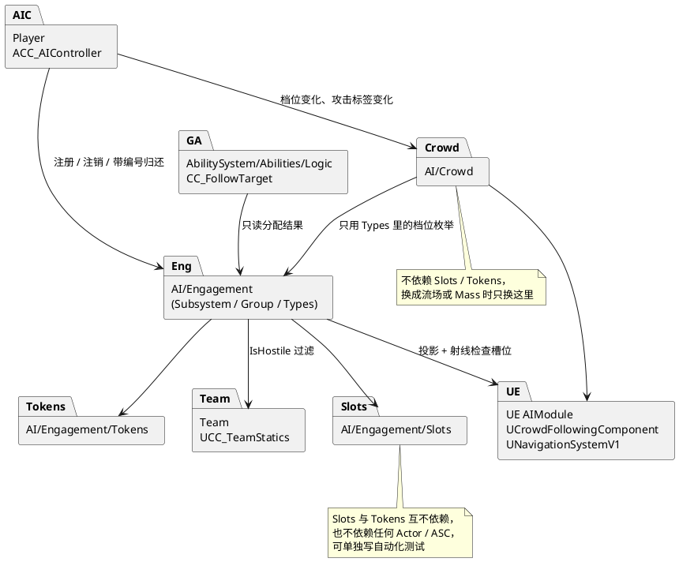

禁止的依赖：`Slots` ↔ `Tokens`、`Crowd` → `Slots/Tokens`、`Slots/Tokens` → 任何 Actor 或能力类、能力 → `Crowd`。攻击能力不依赖 `Engagement`，它们只负责授予 `Attack` 标签。

## 3. 总体架构

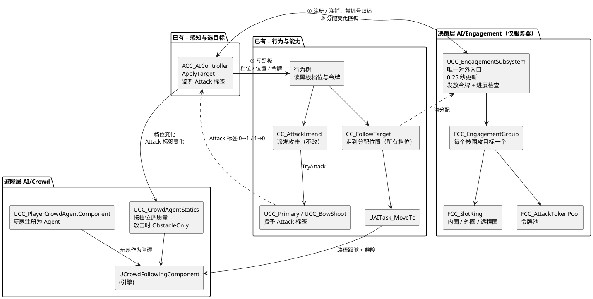

**一句话分工**：控制器决定「打谁」（已有）并负责与子系统对接；子系统决定「站哪、谁能打」并检查进展；行为树决定「现在做什么」；能力只负责执行一次移动或攻击；Crowd 负责「路上别撞」。

**状态归属**：

- 子系统是槽位和令牌的唯一真实来源
- 黑板只是子系统推送过来的副本，供行为树读取
- 控制器是唯一会改动围攻状态的外部调用方（注册、注销、归还）
- 能力完全不维护围攻状态：`CC_FollowTarget` 只读分配，攻击能力只授予标签

**为什么用 WorldSubsystem**：被围攻的不一定是玩家。魅惑后，被魅惑的敌人也会被别的敌人围攻。子系统按目标懒创建围攻组，玩家、随从、被魅惑的敌人共用一套逻辑；目标没有攻击者时自动销毁这个组。

## 4. 核心规则

### 4.1 档位与兵种

档位只表示**参与程度**，兵种用 `bRanged` 单独表示。所有档位的移动都由 `CC_FollowTarget` 走到「分配位置」完成。

| 档位 `ECC_EngagementTier` | 近战的分配位置 | 弓兵（`bRanged`）的分配位置 | 避障质量 |
|---|---|---|---|
| `None` | 没有目标 | 没有目标 | — |
| `Queue` | 外圈之外的排队点 | 远程圈之外的排队点 | Low |
| `Surround` | 外圈槽位 | 远程圈槽位，在此射击 | Medium |
| `Engaged` | 内圈槽位，持有令牌 | 本版不使用 | High |

弓兵过近时的后撤仍由现有的 `CC_KeepDistance` 负责，不改。

### 4.2 槽位环

- 每个环有半径和槽位数，槽位数 = 周长 ÷ 槽位间距，间距至少为「2 × 最大胶囊体半径 + 分离余量」
- 槽位偏移是**世界方向**的，只随目标平移、不随目标朝向旋转，玩家转身时槽位不动；每个槽位加一个固定的小随机偏移，避免站成完美的圆
- **槽位可用**需要同时满足（v2.1 #15）：
  1. 投影到 NavMesh 成功
  2. 从目标位置到槽位做 `NavigationRaycast` 没有被挡
  3. 不在冷却中
- 贴墙时只剩半圆或一段弧是正常结果，多出来的人进入 `Queue`

**增量分配**：

1. 满足以下全部条件的人保留旧槽位：旧槽位仍在本环、可用、未被占，且**怪相对目标的方位与槽位方位夹角不超过 90°**（v2.1 #14）
2. 其余的人按离目标由近到远，各自挑离自己最近的空闲可用槽位
3. 槽位不够时，剩下的人降为 `Queue`

**排队位置**（v2.1 #17）：沿怪自己相对目标的方位，停在所在环半径 + `QueueMargin`（默认 100）处；已经在这个距离之外的原地等待，不移动。

### 4.3 令牌（子系统主动发放）

**发放**（v2.1 #12）：子系统在每个组的周期更新末尾，最多发放一个令牌。条件：

1. 距离本组上次发放 ≥ `MinGrantInterval`（默认 0.4 秒）
2. 实际容量有余：持有数 < min(配置容量, 空闲可用内圈槽位数)
3. 候选人：近战、`Surround` 档、存活、当前时间 ≥ 自己的 `NextEligibleTime`

满足时，从候选人中选**离最近空闲内圈槽位最近**的那个，一步完成：占令牌、占该内圈槽位、档位改为 `Engaged`、编号 +1、记录 `LastGrantTime`。行为树只读黑板上的 `HasAttackToken`，不调用子系统。

**归还**（v2.1 #9）：由控制器监听自己 ASC 上的 `CCAbilities.Attack` 标签。

- 计数 0→1（开始攻击）：记下当前分配编号 `HeldGeneration`，同时把 Crowd 切到 `ObstacleOnly`
- 计数 1→0（攻击或整套连段结束、被打断）：调用 `ReleaseToken(Self, HeldGeneration)`，同时恢复 Crowd
- 子系统只在「确实持有令牌」且「编号一致」时才处理：归还令牌、释放内圈槽位、档位回到 `Surround`、`NextEligibleTime = 现在 + AttackDelay`、编号 +1。否则什么都不做

一张令牌对应一次攻击或一整套连段。连段期间下一段在上一段结束前激活，标签计数不会降到 0，所以不会中途归还。弓兵没有令牌，射击时的标签变化会因为「未持有令牌」被忽略。

**其他回收路径**：目标切换、死亡、被魅惑、解除附身时由控制器注销；进展检查超时由子系统收回；每次更新都会清理已失效的持有者兜底。所有回收都会让编号 +1。

### 4.4 进展检查

只对 `Engaged` 的攻击者做，在周期更新中执行，不需要能力上报。每次更新：

| 情况 | 处理 |
|---|---|
| 正在攻击（带 `Attack` 标签） | 计时清零 |
| 离内圈槽位的距离比最近记录短 25 厘米以上 | 更新最近记录，计时清零 |
| 未到达槽位，且目标移动速度 > `TargetFastSpeed`（默认 300） | 不计时（v2.1 #13，追逃不算卡住） |
| 其他情况，包括已到达但还没出手 | 累计计时（v2.1 #19） |

累计超过 `StuckTimeout`（默认 2 秒）时收回令牌、档位回到 `Surround`、编号 +1。只有在**未到达槽位且自身速度 < `StuckSelfSpeed`（默认 50）**时，才把这个内圈槽位冷却 3 秒；其他情况只收回令牌，不惩罚槽位。

### 4.5 网络

- 只有服务器上的 `ACC_AIController` 会注册攻击者，客户端上的子系统实例没有任何组（实现调整见第 13 节）
- `UCC_PlayerCrowdAgentComponent` 只在服务器上注册到 `UCrowdManager`
- 黑板和行为树本来就只在服务器运行，不受影响

## 5. 类图

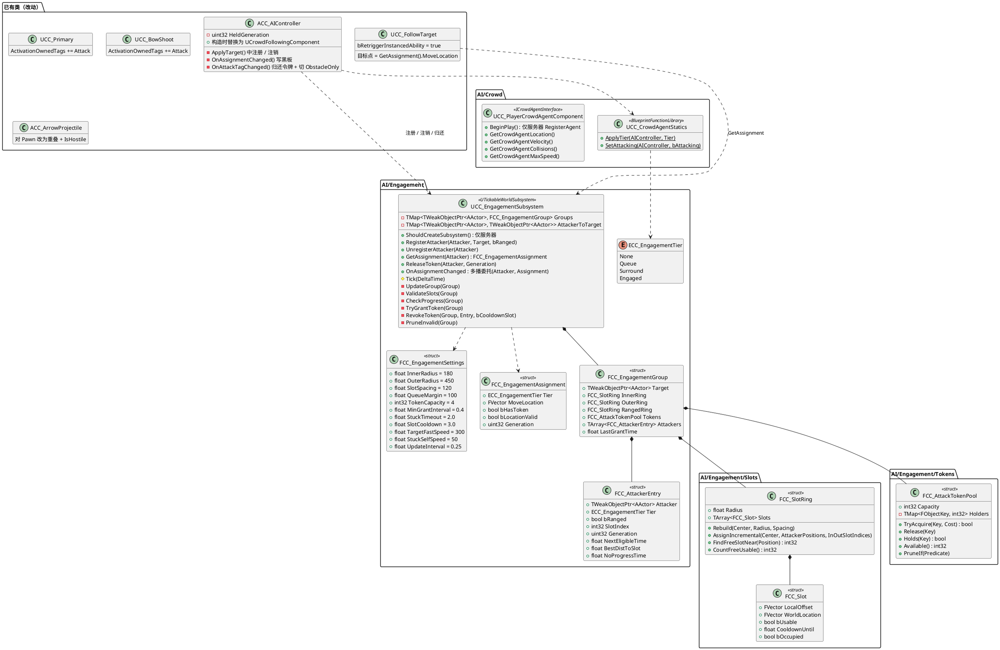

**不改动的已有类**：`CC_AttackIntend`、`CC_KeepDistance`、`CC_FindRangedTarget`、`CC_FindPlayerTarget`。

## 6. 档位状态机

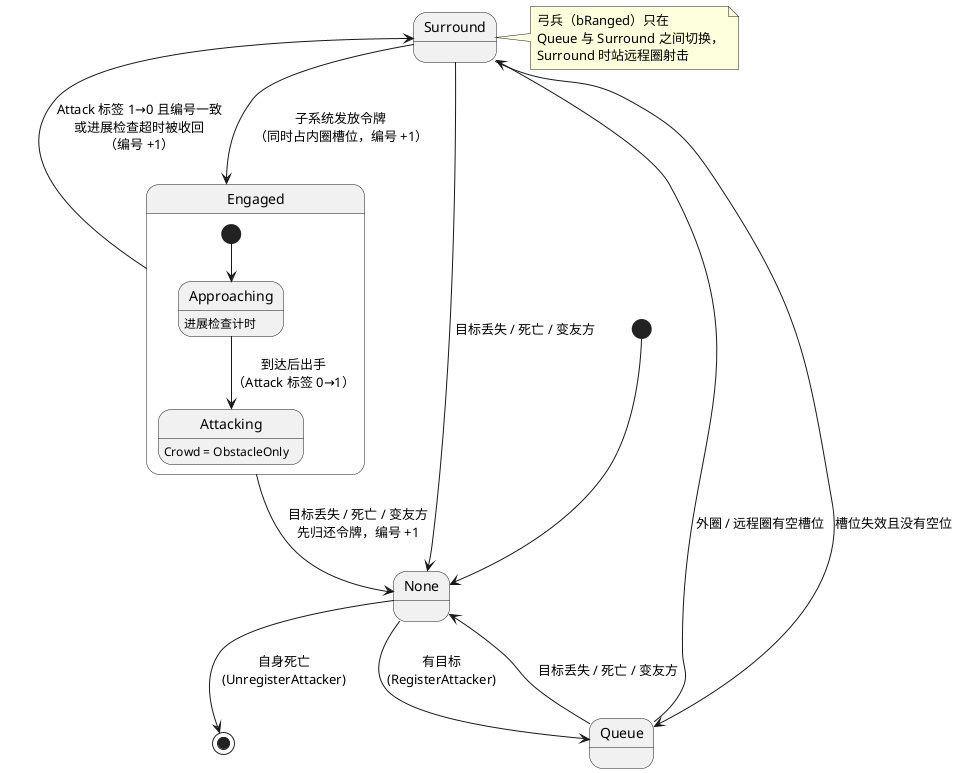

## 7. 时序图

### 7.1 选中目标 → 注册到围攻组

接在已有的 `ACC_AIController::ApplyTarget` 上，魅惑导致的目标变化也走这条路径。

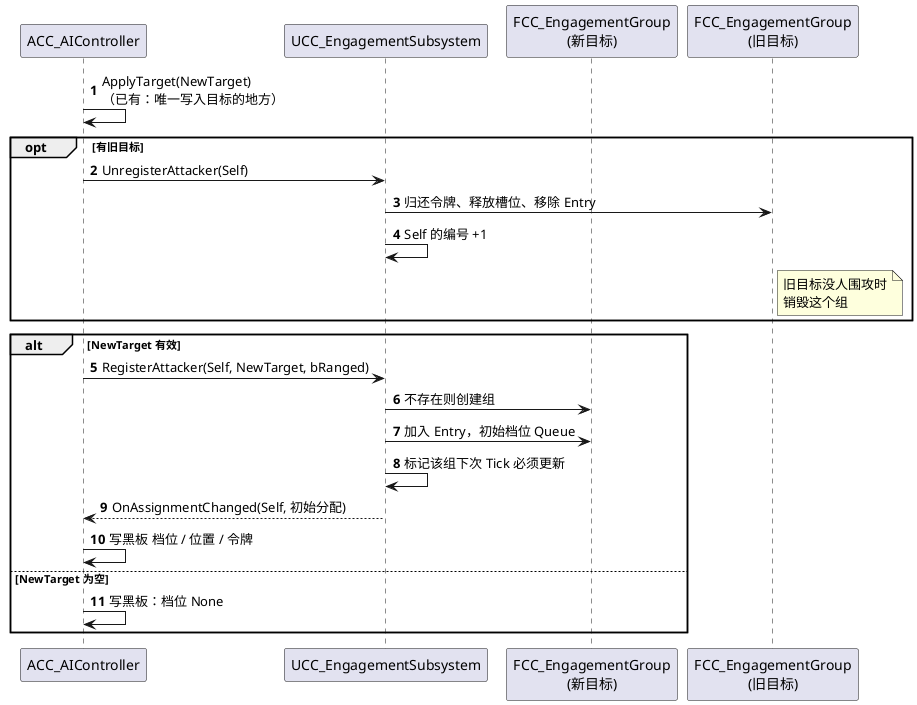

### 7.2 子系统周期更新

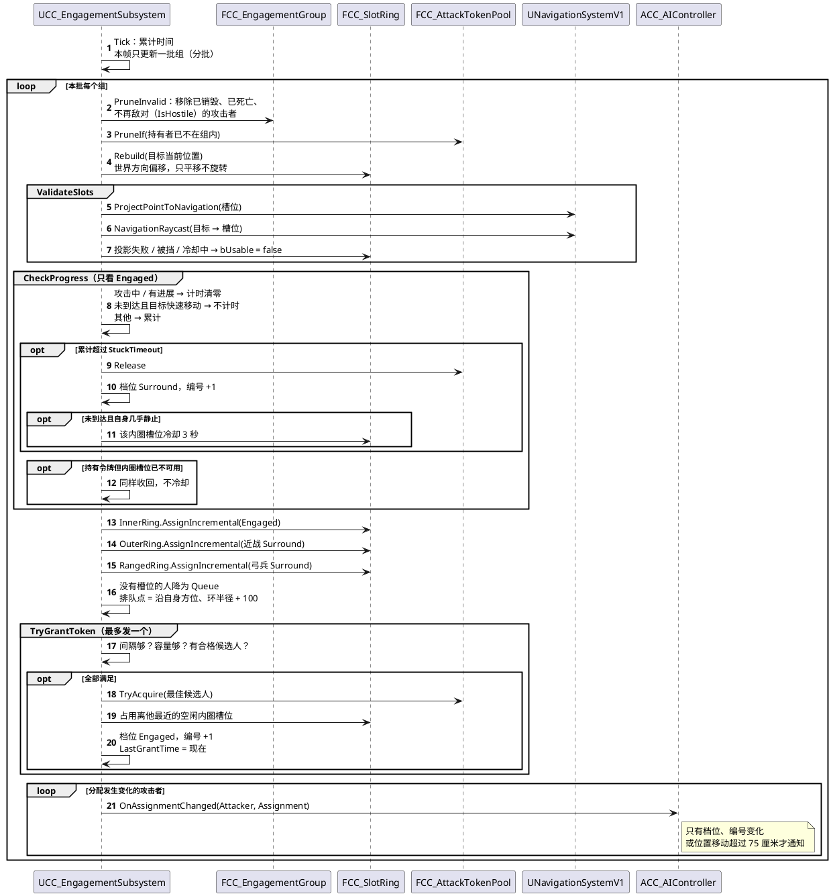

### 7.3 发放令牌 → 攻击 → 按标签归还

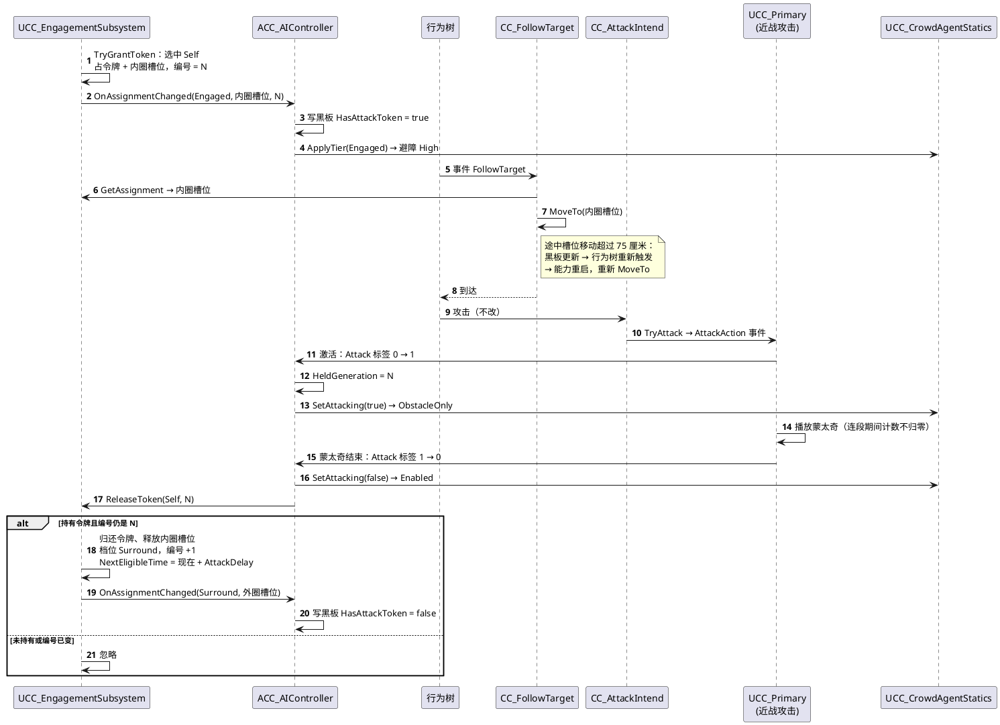

### 7.4 编号如何防止误释放

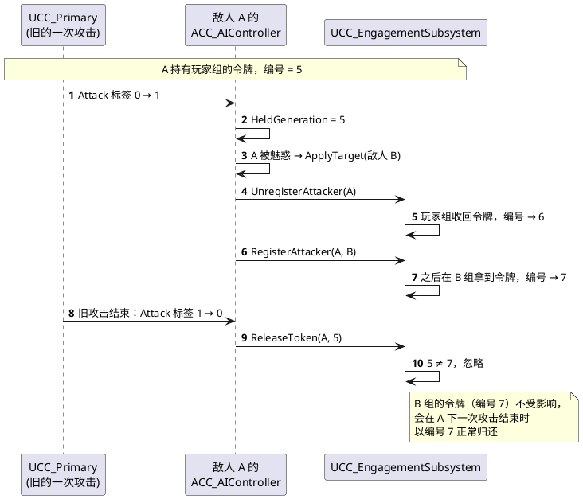

### 7.5 异常回收

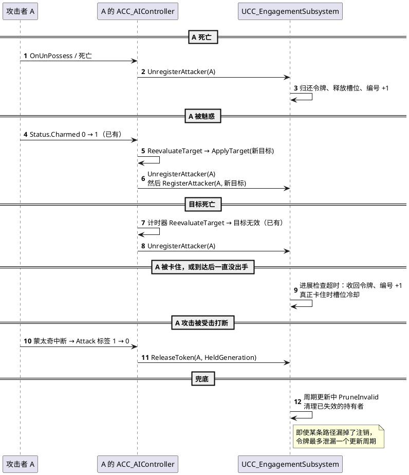

### 7.6 Crowd 接入与玩家注册

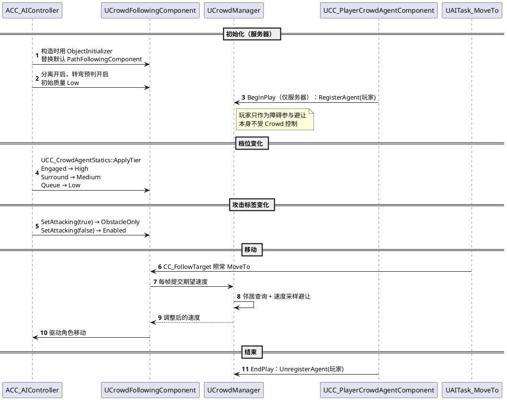

## 8. 增量槽位分配算法

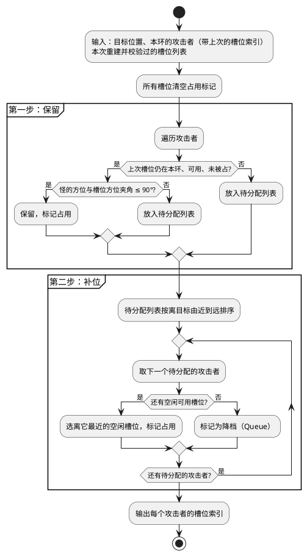

没有全局重排，也就不需要滞回参数。玩家移动时槽位随之平移，大多数人的槽位索引不变，只是位置跟着动。

## 9. 对现有代码的改动清单

| 文件 | 改动 |
|---|---|
| `ACC_AIController` | 构造函数换 `UCrowdFollowingComponent`；`ApplyTarget` 中注册 / 注销；订阅 `OnAssignmentChanged` 写黑板；订阅自己 ASC 的 `CCAbilities.Attack` 标签：0→1 记编号 + `ObstacleOnly`，1→0 带编号归还 + 恢复；`OnUnPossess` 中注销 |
| `CC_FollowTarget` | 目标点改为 `GetAssignment().MoveLocation`，位置无效时回退到现有的角度候选逻辑；`bRetriggerInstancedAbility = true` |
| `UCC_Primary` | 构造函数 `ActivationOwnedTags.AddTag(CCTags::CCAbilities::Attack)` |
| `UCC_BowShoot` | 恢复被注释掉的那一行 `ActivationOwnedTags.AddTag(CCTags::CCAbilities::Attack)` |
| `ACC_ArrowProjectile` | 对 Pawn 通道改为重叠，在重叠回调里用 `IsHostile` 判断；友方穿过，敌方命中后销毁 |
| `ACC_PlayerCharacter` | 挂 `UCC_PlayerCrowdAgentComponent` |
| `ACC_EnemyCharacter` | 删除注释掉的 RVO 代码，避免误开导致与 Crowd 冲突 |
| `CC_Dash` | **待你决定**：保留 `ActivationBlockedTags = Attack`（攻击中不能冲刺），或删除它（允许冲刺取消攻击） |
| 黑板资产 | 新增键 `EngagementTier`（枚举）、`MoveLocation`（向量）、`HasAttackToken`（布尔） |
| 行为树资产 | Queue / Surround → FollowTarget 去分配位置（弓兵 Surround 时射击）；Engaged → FollowTarget 去内圈槽位，到达后攻击；`MoveLocation` 键变化时中止并重新触发 FollowTarget |
| 项目设置 | Crowd Manager 的 `MaxAgents` 调到敌人上限 + 余量，`MaxAgentRadius` 大于最大胶囊体半径 |

**不改动**：`CC_AttackIntend`、`CC_KeepDistance`、`CC_FindRangedTarget`、`CC_FindPlayerTarget`。黑板也不需要存编号，编号只在控制器内部记录。

## 10. 测试计划

纯逻辑部分写自动化测试（命名 `GAS_Demo.AI.Engagement.*`）：

- `FCC_SlotRing`：槽位数随半径和间距正确计算；增量分配保留有效旧槽位；夹角超过 90° 时重新分配；槽位不够时离得远的人降档；冷却中的槽位不被分配
- `FCC_AttackTokenPool`：容量与消耗值；重复申请幂等；释放后可再申请；`PruneIf` 清理失效持有者
- 子系统：
  - 内圈没有空闲可用槽位时不发放令牌（#1、#5）
  - 旧编号的 `ReleaseToken` 不影响新令牌；未持有令牌时 `ReleaseToken` 无效果（#2、#9）
  - 未到达且自身静止超时：收回 + 槽位冷却；目标快速移动时不计时；到达但未出手超时：收回、不冷却（#3、#13、#19）
  - 同一组两次发放间隔不小于 `MinGrantInterval`，每次更新最多发一个（#6、#12）
  - 归还后 `NextEligibleTime` 生效，期间不会再被选中
  - 注册 / 注销；被魅惑后转组；目标死亡时整组清空

编辑器内手动验证：

- 刷 100 近战 + 20 弓兵，Unreal Insights 记录 Crowd、子系统、感知、动画各自的耗时
- 玩家贴墙、站在走廊、站在薄墙边：确认进场人数自动减少、没有怪被分到墙后
- 玩家绕圈跑：确认交战中的怪不会因为追不上被频繁收回令牌，也不会守着对面的槽位
- 弓兵在包围圈外射击：确认箭穿过友军命中玩家
- 加一个调试绘制：每个组的槽位（可用 / 冷却 / 占用）和令牌持有者

## 11. 待确认的参数

| 参数 | 建议起始值 | 根据什么调整 |
|---|---|---|
| 令牌容量 | 4 | 战斗节奏，玩家能同时应付几个人 |
| `MinGrantInterval` | 0.4 秒 | 希望出手错开的程度（实际约每 0.5 秒一个，受更新间隔影响） |
| `StuckTimeout` | 2 秒 | 地形复杂程度 |
| 槽位冷却 | 3 秒 | 同上 |
| `TargetFastSpeed` | 300 | 玩家跑步速度，略低于它 |
| `StuckSelfSpeed` | 50 | 判断「真的卡住」的速度阈值 |
| 内圈半径 | 近战攻击距离 + 胶囊体半径，约 180 | 敌人攻击范围 |
| 外圈半径 | 450 | 要有压迫感但不挡住内圈进出 |
| 槽位间距 | 2 × 最大胶囊体半径 + 40 | 敌人体型 |
| `QueueMargin` | 100 | 排队区与外圈的距离 |
| 更新间隔 | 0.25 秒 | 敌人数量和玩家移动速度 |

## 12. 后续可选改进（本版不做）

| 改进 | 解决什么 | 什么时候考虑 |
|---|---|---|
| 攻击后的「恢复」阶段 | 怪物轮流上场、内外圈来回移动太多 | 实测觉得节奏机械时 |
| 能力主动上报执行结果 | 比周期检查更快发现受阻 | 2 秒的卡住判定显得太慢时 |
| 跨组槽位冲突检查 | 玩家和随从站得近时两组外圈重叠 | 双目标混战经常拥堵时 |
| 弓兵齐射预算 | 远程同时齐射 | 弓兵数量多、玩家觉得不公平时 |
| 档位 / 兵种 / 更新策略完全拆成三个维度 | 近战远程两用的怪 | 出现这类敌人时 |

## 13. 实现时的细节调整

| 位置 | 文档原写法 | 实际实现 | 原因 |
|---|---|---|---|
| 子系统创建 | `ShouldCreateSubsystem` 判断 `NetMode != NM_Client` | 只判断 World 类型（Game / PIE） | 子系统创建时客户端的网络驱动可能还没就绪，NetMode 不可靠；客户端没有 AIController，不会有注册，Tick 立即返回 |
| 持令牌者的内圈槽位失效 | 直接收回令牌 | 先在内圈里换一个空闲可用槽位，没有才收回（不冷却） | 只是这个槽位不能用，不代表内圈没位置，换位比收回更平滑 |
| `CC_FollowTarget` | 只改 `bRetriggerInstancedAbility` | 同时新增 `EndAbility`：先解绑再结束旧的 `UAITask_MoveTo` | 否则旧任务被新的移动请求顶掉时，会回调到新激活的实例，把它也结束掉 |
| 攻击开始时切 `ObstacleOnly` | 直接切换 | 路径跟随不空闲时先 `StopMovement` 再切换 | 引擎只允许在路径跟随空闲时切换 Crowd 模拟状态 |
| 远程圈半径 | 「MinRange～MaxRange 之间」 | 第一个加入该组的弓兵的 (MinRange + MaxRange) / 2，且不小于外圈半径 + 槽位间距；组存在期间不变 | 半径不变才能保证槽位索引稳定 |
| 参数配置 | 未说明 | `UCC_EngagementSubsystem` 的 `Config` 属性，在 `DefaultGame.ini` 中覆盖 | 不新增设置类 |
| 调试 | 未说明 | 控制台变量 `cc.Engagement.Debug 1` 绘制槽位和令牌持有者 | 便于调参 |
| 注册自愈 | 只在 `ApplyTarget` 中注册 | 控制器 0.5 秒一次的 `ReevaluateTarget` 中，仍有目标时再调用一次注册（同一目标时无操作） | 子系统兜底清理后，若控制器的目标没变，`ApplyTarget` 不会再被调用 |
