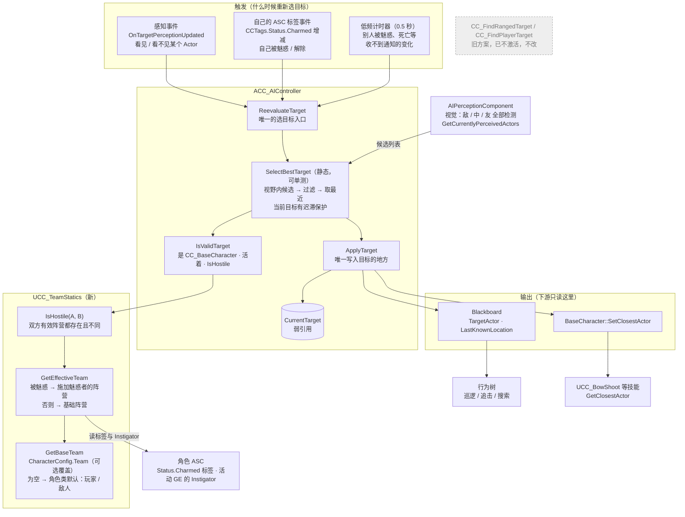
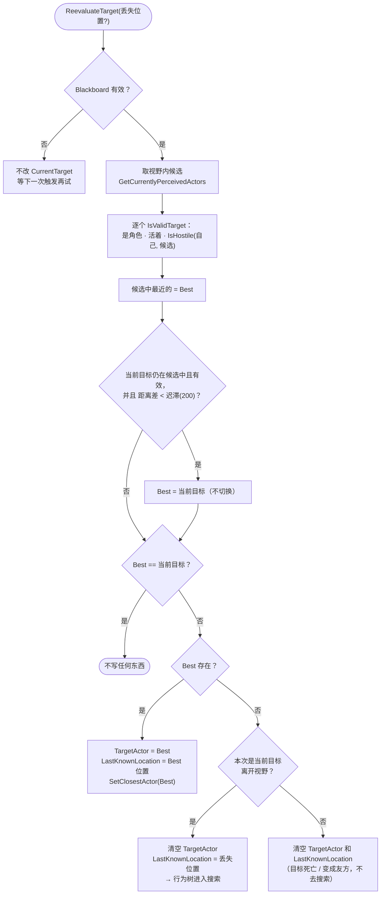
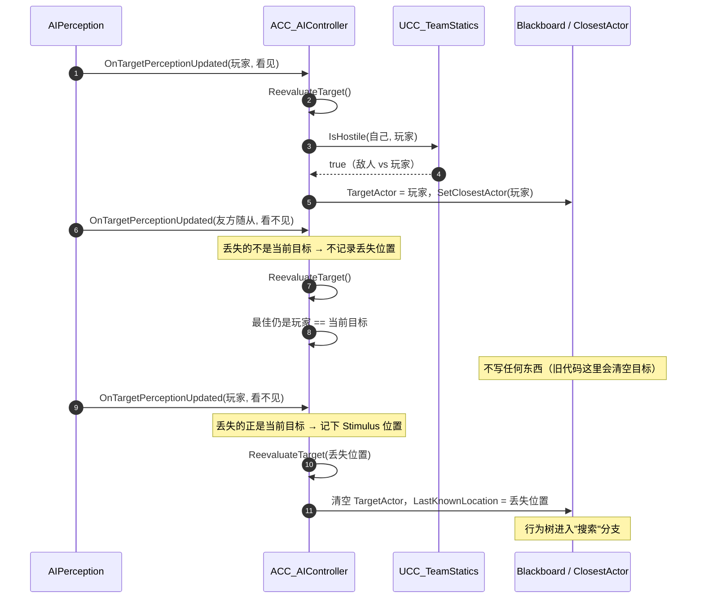
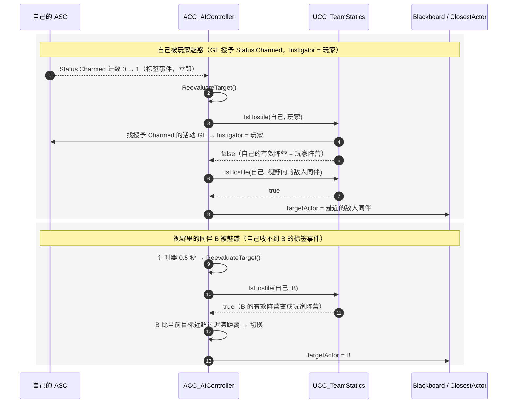
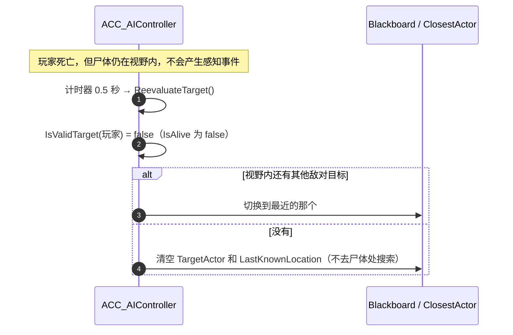

# AI 寻敌逻辑

## 1. 结构

## 2. ReevaluateTarget 的判断流程

## 3. 时序

### 3.1 看见玩家，随从离开视野（修复"丢任何一个就清空目标"）

### 3.2 魅惑：自己被魅惑 / 视野里的同伴被魅惑

### 3.3 目标死亡

## 4. 需要你确认的行为变化

1. **敌人之间不再互相攻击。**
   - 现在 `ACC_EnemyCharacter` 构造时被打上 `Follower` 标签，而控制器会把 `Player` 或 `Follower` 都当作目标，所以敌人会锁定视野里的其他敌人。
   - 改完后，敌人默认属于 `CCTags.Team.Enemy`，玩家默认属于 `CCTags.Team.Player`，同阵营不再互打。
   - 如果你的"随从"是站在玩家一边的 AI，在它的 CharacterConfig 里把 `Team` 设成 `CCTags.Team.Player` 即可。
   - 如果同一个敌人蓝图要临时站到玩家一边（召唤物），生成时调用 `ACC_BaseCharacter::SetTeamOverride`，优先级高于 CharacterConfig，见 [SummonAlly.zh-CN.md](SummonAlly.zh-CN.md)。
2. **目标死亡或变成友方时，`LastKnownLocation` 会被清空。** 旧代码不会清空它，所以玩家死后，AI 会走到尸体处去搜索。
3. **魅惑只在服务器生效。** 阵营判断要读活动 GE，而敌人的 ASC 是 Minimal 复制模式，客户端拿不到活动 GE。AI、伤害、索敌本来就只在服务器运行，所以没有影响。
