> **已被 v3 取代（2026-10-20）**：槽位 + 令牌方案已删除，现行设计与接入步骤见 `Docs/AI/AI-Combat.zh-CN.md`。本文仅作历史记录。

# 怪物包围寻路设计（槽位 + 令牌 + Detour Crowd）v2.2

> 已按 2026-10-20 当前工作区源码核对类名、成员和调用流程。接入与调参步骤见 [使用说明](AI-Engagement-Usage.zh-CN.md)。第 13 节记录实现细节与边界。
> 目标规模：同屏 100～150 只敌人（近战为主，含弓兵）。
> 所有图均为 PlantUML，可直接粘贴到语雀的「文本绘图 → PlantUML」块中。

## 0. 修改记录

实现原则：**只修会导致错误行为的漏洞，不新增类和子系统**。本次 v2.2 仅同步文档，没有修改运行时代码或行为树资产。

### v2.2：按当前源码同步设计图

- 类图补齐实际函数名、参数、返回值、可见性和成员类型；图中省略的是与围攻无关的成员，不使用虚构函数表示实际调用。
- 区分子系统委托 `OnAssignmentChanged`、控制器回调 `OnEngagementAssignmentChanged` 和订阅句柄 `AssignmentChangedHandle`。
- 换目标时由 `RegisterAttacker` 内部调用 `RemoveAttacker(Key, false)` 静默移出旧组；周期更新通过 `NotifyIfChanged` 排队通知，再由 `FlushNotifies` 广播。
- 同步令牌归还、死亡清理、编号校验、Crowd 注册对象和移动任务调用链；明确行为树结构仍需按使用说明配置。

### v2：设计逻辑漏洞

| # | 漏洞 | 修法 |
|---|---|---|
| 1 | 先发令牌，下一次更新才分内圈槽位，贴墙时拿到令牌却没地方站 | 发令牌与占内圈槽位为同一步，没有可用槽位就不发 |
| 2 | 归还只认攻击者，换目标后旧攻击结束会误放新令牌 | 每次发令牌生成分配编号，归还必须带编号 |
| 3 | 卡住的怪一直占着令牌和槽位 | 周期更新中做进展检查，超时收回 |
| 4 | 全局按总距离重排，玩家一动怪物就换边 | 增量分配：有效旧槽位保留，只给需要的人补位 |
| 5 | 令牌容量固定，贴墙时回到漏洞 1 | 同时检查令牌余量和空闲可用内圈槽位；两者都有才发放 |
| 6 | 令牌只限人数，几只怪可能同一帧出手 | 同一目标两次发令牌至少间隔 `MinGrantInterval`；错开发放不等于保证实际攻击起手错开 |
| 7 | 档位枚举混入兵种 `Ranged` | 枚举删除 `Ranged`，兵种用 `bRanged` |

### v2.1：与现有代码对接时发现的问题

| # | 问题 | 修法 |
|---|---|---|
| 8 | 没有任何能力授予 `CCAbilities.Attack`，依赖它的 `ObstacleOnly` 切换和进展检查都不生效 | 近战攻击能力 `UCC_Primary` 和 `UCC_BowShoot` 构造函数中 `ActivationOwnedTags` 加上它 |
| 9 | `CC_AttackIntend` 只是派发者，在它结束时归还令牌时机不对 | 控制器监听 `Attack` 标签：0→1 记下编号，1→0 带编号归还。`CC_AttackIntend` 不改 |
| 10 | `CC_KeepDistance` 在 `MinRange <= 0` 时直接失败，且只在过近时后撤，不能做近战外圈移动 | 所有档位的「走到分配位置」统一用 `CC_FollowTarget`；`CC_KeepDistance` 只保留给弓兵后撤，不改 |
| 11 | `CC_FollowTarget` 不允许重新触发，移动途中收不到新槽位 | 改为 `bRetriggerInstancedAbility = true` |
| 12 | 行为树主动申请令牌，谁先 Tick 谁先拿，会让对面的怪穿过包围圈 | 子系统在周期更新中主动发放给最合适的人；删除对外的 `RequestToken` |
| 13 | 玩家逃跑时，追击者离槽位不缩短，被误判为卡住 | 目标快速移动时不计时；只有自身几乎静止时才冷却槽位 |
| 14 | 只要槽位有效就保留，玩家跑过去后怪要绕到另一侧 | 怪的方位与槽位方位夹角超过 90° 视为失效 |
| 15 | 薄墙另一侧的槽位能投影成功，但要绕很远 | 再从目标向槽位做一次 `NavigationRaycast`，被挡则不可用 |
| 16 | 箭被包围圈里的近战友军挡住销毁 | 箭对 Pawn 改为重叠检测，用 `IsHostile` 判断，友方穿过 |
| 17 | 排队位置描述有歧义 | 沿自身方位停在外圈半径 + `QueueMargin`；已在更远处就原地等 |
| 18 | 网络归属未说明 | 子系统在 Game / PIE World 创建，正常由服务器 AIController 注册攻击者；玩家 Crowd Agent 只在服务器注册 |
| 19 | 持令牌到达槽位后若一直不出手，会永久占用令牌 | 进展检查中「到达但未攻击」同样计时，超时收回 |

**当前冲刺行为**：`UCC_Dash` 的 `ActivationBlockedTags` 包含 `CCTags::CCAbilities::Attack`，攻击状态存在时不能激活冲刺。移除阻断只表示允许激活冲刺，并不自动取消正在执行的攻击能力；攻击取消策略需要另行定义。

**本版不做**（属于后续改进）：攻击后的「恢复」阶段、跨组槽位冲突检查、弓兵齐射预算、能力主动上报执行结果。

## 1. 目标与范围

| 要解决的问题 | 负责部分 |
|---|---|
| 所有敌人都追同一个点，围成一团 | 槽位 |
| 太多敌人同时贴身攻击，玩家读不懂局面，开销也大 | 令牌 |
| 去目标点的路上互相顶住、滑开 | Detour Crowd |
| 上百只时开销失控 | 按档位降级 |

**不在本设计范围内**：感知层的 N² 问题、动画预算、网络复制优化。

## 2. 文件夹与模块

```
Public/AI/
├── CC_AIController.h             感知、目标选择、围攻与避障接入
├── Engagement/                    决策层：谁去哪、谁能打
│   ├── CC_EngagementTypes.h       共享类型：档位枚举、分配结果、配置
│   ├── CC_EngagementSubsystem.h   协调者：唯一对外入口，组合槽位与令牌
│   ├── CC_EngagementGroup.h       单个目标的围攻组（内含槽位环 + 令牌池）
│   ├── Slots/
│   │   └── CC_SlotRing.h          纯逻辑：生成环形槽位、增量分配
│   └── Tokens/
│       └── CC_AttackTokenPool.h   纯逻辑：令牌发放、回收
└── Crowd/                         避障层：路上怎么不撞
    ├── CC_CrowdAgentStatics.h     按档位切换避障质量、攻击时切 ObstacleOnly
    └── CC_PlayerCrowdAgentComponent.h  让玩家注册为 Crowd Agent 的组件
（Private/AI/ 下同结构放 .cpp）
```

分两个模块而不是三个平级文件夹：槽位和令牌需要一个协调者（发令牌必须同时占内圈槽位），所以放在同一个 `Engagement` 模块下作为互不依赖的纯逻辑子目录；Crowd 是另一层，只看档位，不知道槽位和令牌。

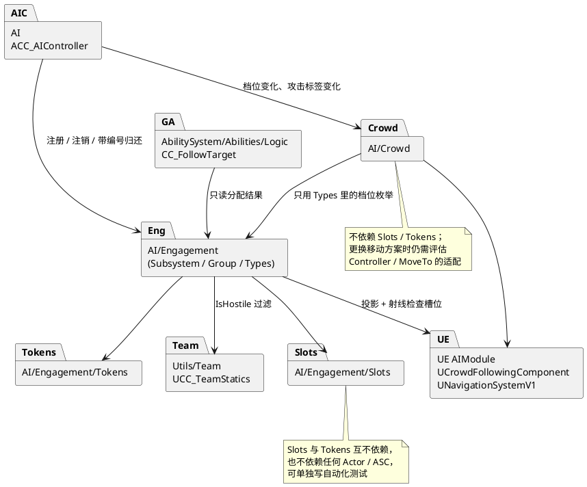

禁止的依赖：`Slots` ↔ `Tokens`、`Crowd` → `Slots/Tokens`、`Slots/Tokens` → 任何 Actor 或能力类、能力 → `Crowd`。攻击能力不依赖 `Engagement`，它们只负责授予 `Attack` 标签。

## 3. 总体架构

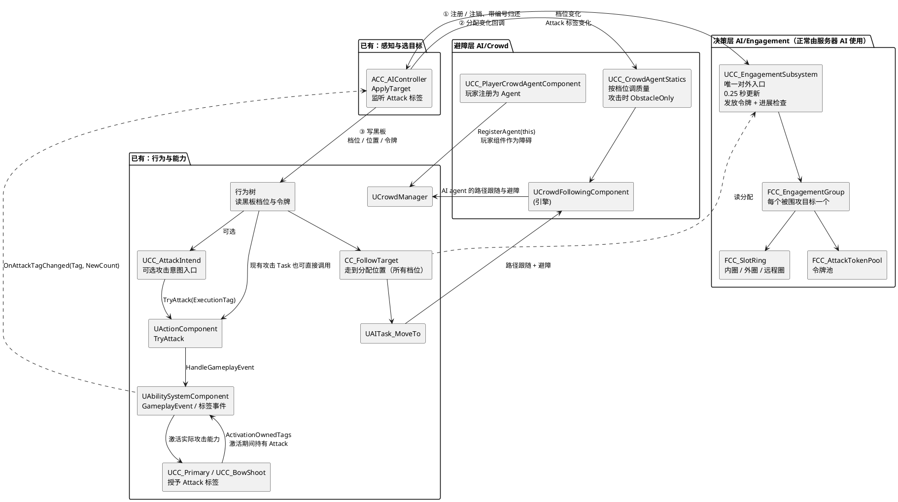

**一句话分工**：控制器决定「打谁」（已有）并负责与子系统对接；子系统决定「站哪、谁能打」并检查进展；行为树决定「现在做什么」；能力只负责执行一次移动或攻击；Crowd 负责「路上别撞」。

**状态归属**：

- 子系统是槽位和令牌的唯一真实来源
- 黑板只是子系统推送过来的副本，供行为树读取
- 控制器是唯一会改动围攻状态的外部调用方（注册、注销、归还）
- 能力完全不维护围攻状态：`CC_FollowTarget` 只读分配，攻击能力只授予标签

**为什么用 UTickableWorldSubsystem**：每个 Game / PIE World 有自己的管理器实例，由引擎创建并调用 `Tick`，不是进程全局单例。被围攻的不一定是玩家；子系统按目标懒创建围攻组，玩家、随从、被魅惑的敌人共用一套逻辑。组内没有攻击者时移除该组，不销毁目标 Actor。空组时 `Tick` 直接返回。

## 4. 核心规则

### 4.1 档位与兵种

档位只表示**参与程度**，兵种用 `bRanged` 单独表示。所有档位的移动都由 `CC_FollowTarget` 走到「分配位置」完成。

| 档位 `ECC_EngagementTier` | 近战的分配位置 | 弓兵（`bRanged`）的分配位置 | 避障质量 |
|---|---|---|---|
| `None` | 未注册或已退出围攻组 | 未注册或已退出围攻组 | Low |
| `Queue` | 外圈之外的排队点 | 远程圈之外的排队点 | Low |
| `Surround` | 外圈槽位 | 远程圈槽位，在此射击 | Medium |
| `Engaged` | 内圈槽位，持有令牌 | 本版不使用 | High |

弓兵过近时的后撤仍由现有的 `CC_KeepDistance` 负责，不改。

### 4.2 槽位环

- `FCC_SlotRing::ComputeSlotCount` 计算槽位数：`max(1, floor(2π × Radius / Spacing))`；半径或间距过小时返回 1。槽位间距建议至少为「2 × 最大胶囊体半径 + 分离余量」，代码不会自动读取胶囊尺寸强制这个下限。
- 槽位偏移是**世界方向**的，只随目标平移、不随目标朝向旋转，玩家转身时槽位不动；每个槽位加一个固定的小随机偏移，避免站成完美的圆
- **有导航系统时的槽位校验**由 `RebuildRings` 调用 `ValidateRing` 完成（v2.1 #15）：
  1. 投影到 NavMesh 成功
  2. 目标自身投影成功时，从投影后的目标位置到槽位做 `NavigationRaycast` 没有被挡
  3. 不在冷却中
- 贴墙时只剩半圆或一段弧是正常结果，多出来的人进入 `Queue`

当前实现没有导航系统时跳过 `ValidateRing`，保留重建后的原始位置；目标自身投影失败时跳过射线检查。这些位置并不因此保证可达，移动任务仍可能失败。

**增量分配**：

1. 满足以下全部条件的人保留旧槽位：旧槽位仍在本环、可用、未被占，且**怪相对目标的方位与槽位方位夹角不超过 90°**（v2.1 #14）
2. 其余的人按离目标由近到远，各自挑离自己最近的空闲可用槽位
3. 没有空位时输出 `INDEX_NONE`；`AssignSlots` 对外圈 / 远程圈成员降为 `Queue`，对内圈持有者调用 `RevokeToken`，再尝试放回外圈，没有外圈位置才进入 `Queue`

**排队位置**（v2.1 #17）：沿怪自己相对目标的方位，停在所在环半径 + `QueueMargin`（默认 100）处；已经在这个距离之外的原地等待，不移动。

### 4.3 令牌（子系统主动发放）

**发放**（v2.1 #12）：子系统在每个组的周期更新末尾，最多发放一个令牌。条件：

1. 距离本组上次发放 ≥ `MinGrantInterval`（默认 0.4 秒）
2. 对候选人满足 `Group.Tokens.Available() >= Entry.TokenCost`，并能由 `InnerRing.FindFreeSlotNear` 找到一个空闲可用槽位；不是比较「持有数 < 空闲槽位数」
3. 候选人：近战、`Surround` 档、Actor 有效、不在攻击中、当前时间 ≥ 自己的 `NextEligibleTime`；存活和敌对关系先由 `PruneInvalid` 检查

满足时，从候选人中选**离最近空闲内圈槽位最近**的那个，一步完成：`Tokens.TryAcquire(Key, TokenCost)`、释放原外圈槽位、占内圈槽位、档位改为 `Engaged`、通过 `AllocateGeneration()` 分配新编号、记录 `LastGrantTime`。当前 `TokenCost` 默认 1；没有按等待时长或屏幕可见性排序。行为树读取黑板，不调用申请令牌接口。

`MinGrantInterval` 限制的是发放时刻；移动耗时不同仍可能导致多只怪同时起手。子系统也没有在实际攻击能力入口强制检查令牌，近战行为树必须在攻击前检查资格。

**归还**（v2.1 #9）：由控制器监听自己 ASC 上的 `CCAbilities.Attack` 标签。

- `BindEngagementEvents` 使用 `NewOrRemoved` 监听标签从 0 到非零、从非零到 0 的变化；不监听非零计数之间的变化
- 从 0 到非零（开始攻击）：`OnAttackTagChanged` 记下当前分配编号 `HeldGeneration`，调用 `SetAttacking(this, true)`
- 从非零到 0（所有攻击状态来源结束）：先调用 `SetAttacking(this, false)` 恢复 Crowd，再调用 `ReleaseToken(BaseCharacter, HeldGeneration)`
- 子系统只在「档位为 Engaged、确实持有令牌、编号一致」时处理：释放内圈槽位和令牌、分配新编号、设置 `NextEligibleTime = 现在 + AttackDelay`，再由 `PlaceInSurroundRing` 放回外圈；没有空位时进入 `Queue`。否则忽略

一张令牌持续到攻击标签计数归零。如果连段交接时始终有能力持有标签，就可以覆盖整套连段；如果交接中计数降到 0，就会触发归还，不能仅凭「连段」假定标签一直存在。弓兵仍会切换 Crowd，但其归还调用因未持有令牌而被忽略。`ActivationOwnedTags` 才会向 ASC 授予状态，仅设置 Ability Asset Tags 不会触发这种通知。

**其他回收路径**：目标切换由 `RegisterAttacker` 内部静默移出旧组；无目标或解除附身调用 `UnregisterAttacker`；死亡等失效情况由 `PruneInvalid` 兜底；超时由 `RevokeToken` 收回。归还 / 收回时重新分配编号，移除条目时直接丢弃编号，退出通知使用默认分配（`Generation = 0`）。编号是子系统级 `int32` 序列，不保证同一怪的新编号恰好等于旧编号 +1，达到 `MAX_int32` 后回到 1。

### 4.4 进展检查

只对 `Engaged` 的攻击者做，在周期更新中执行，不需要能力上报。每次更新：

| 情况 | 处理 |
|---|---|
| 正在攻击（带 `Attack` 标签） | 计时清零 |
| 离内圈槽位的距离比最近记录短 25 厘米以上 | 更新最近记录，计时清零 |
| 未到达槽位，且目标移动速度 > `TargetFastSpeed`（默认 300） | 不计时（v2.1 #13，追逃不算卡住） |
| 其他情况，包括已到达但还没出手 | 累计计时（v2.1 #19） |

累计达到 `StuckTimeout`（默认 2 秒）时调用 `RevokeToken`，分配新编号并尝试返回外圈，没有位置时进入 `Queue`。只有在**未到达槽位且自身速度 < `StuckSelfSpeed`（默认 50）**时，才把这个内圈槽位冷却 `Settings.SlotCooldown`（默认 3 秒）；其他情况只收回令牌，不惩罚槽位。`AssignSlots` 还会处理内圈槽位失效：先尝试换位，没有可分配的内圈槽位才收回令牌。

### 4.5 网络

- 只有服务器上的 `ACC_AIController` 会注册攻击者，客户端上的子系统实例没有任何组（实现调整见第 13 节）
- `UCC_PlayerCrowdAgentComponent` 只在服务器上注册到 `UCrowdManager`
- 黑板和行为树本来就只在服务器运行，不受影响

## 5. 类图

以下成员与当前头文件对应；为可读性省略 `UPROPERTY`、`UFUNCTION`、部分 `const` / 引用修饰及与围攻无关的成员。`+` 表示 public，`#` 表示 protected，`-` 表示 private。

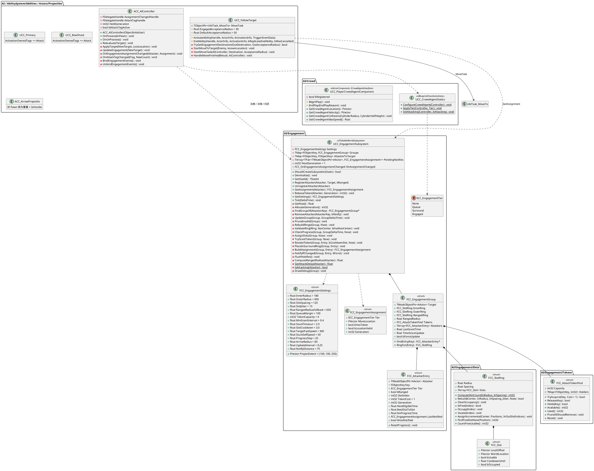

**订阅名称不要混淆**：`FCC_OnEngagementAssignmentChanged` 是委托类型，`OnAssignmentChanged` 是子系统的委托成员，`OnEngagementAssignmentChanged` 是控制器回调，`AssignmentChangedHandle` 是 `AddUObject` 返回的订阅句柄。`BindEngagementEvents` 绑定，`UnbindEngagementEvents` 使用句柄解绑。

**复用的已有能力**：`UCC_AttackIntend` 只派发攻击，不归还令牌；`UCC_KeepDistance` 只负责过近后撤；`UCC_FindRangedTarget`、`UCC_FindPlayerTarget` 不负责槽位和令牌分配。这表示围攻职责边界，不表示这些文件从未发生其他修改。

## 6. 档位状态机

这里描述的是子系统中的档位；Approaching / Attacking 是行为阶段示意，不是额外的 C++ 枚举值。档位变化通知后，行为树仍需配置对应分支才能执行移动 / 攻击。

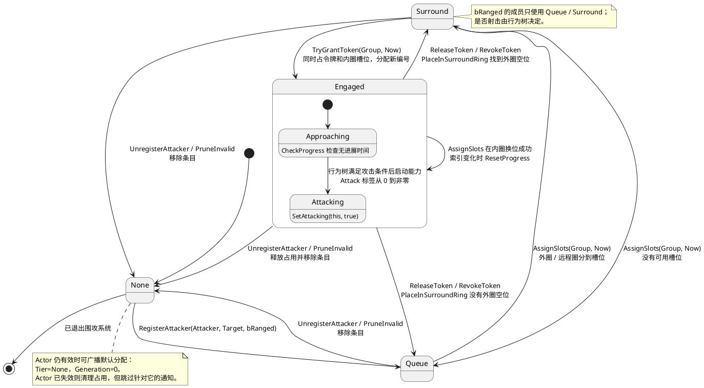

## 7. 时序图

图中 Attacker / BaseCharacter 指被控制的角色，不是 Controller；下面不使用含糊的 Self 代替两者。省略引擎生命周期回调的固定参数时，以对应头文件签名为准。

### 7.1 订阅通知 → 选中目标 → 注册到围攻组

OnPossess 先调用 BindEngagementEvents。ApplyTarget 写入目标后调用 UpdateEngagement；换目标时只调用新目标的注册，由子系统内部处理旧组，不显式广播一次 None。

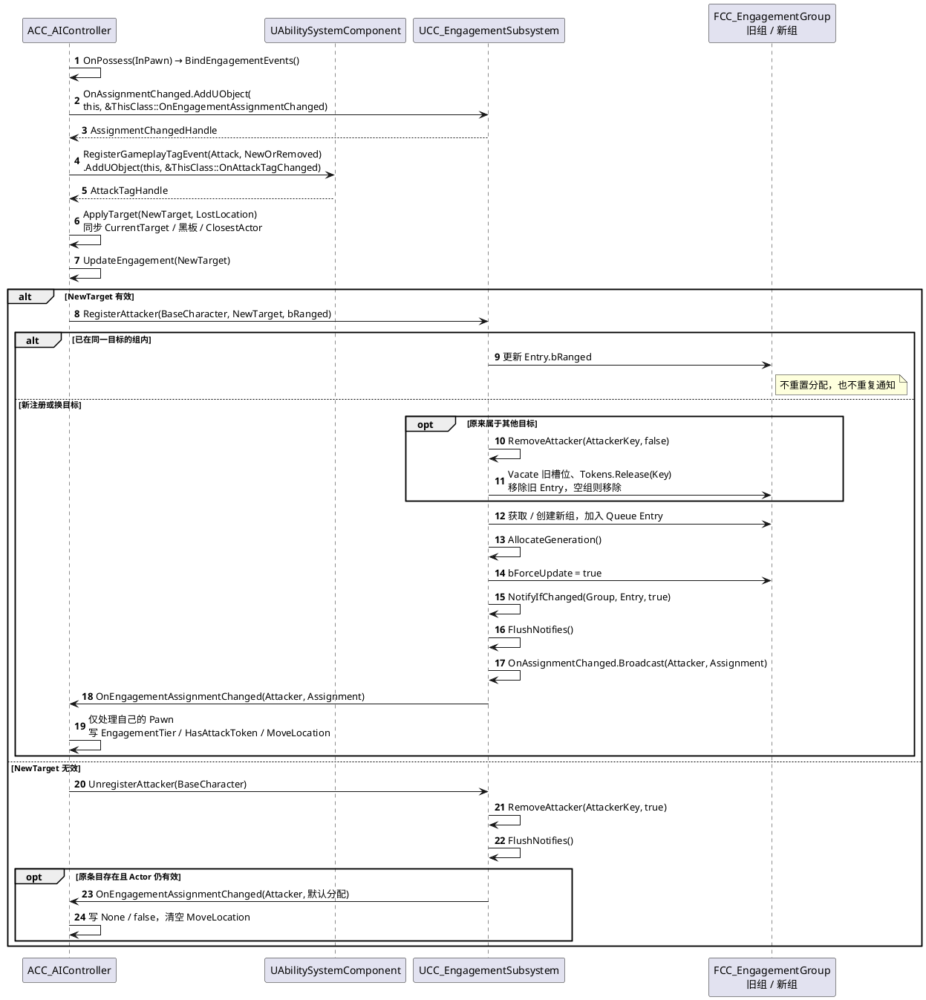

ReevaluateTarget() 还会在目标未变时调用 UpdateEngagement(Target) 自愈注册，默认计时器间隔为 TargetReevaluateInterval = 0.5 秒。RegisterAttacker 同目标路径是幂等操作。订阅本身不会立即补发当前标签状态。

### 7.2 子系统周期更新

Tick 每帧遍历全部现有组，满足 bForceUpdate 或组累计时间达到更新间隔时才更新；当前没有每帧最多处理几组 / 几个槽位的预算上限。新组累计时间随机错开，但强制更新仍可在同一帧发生。

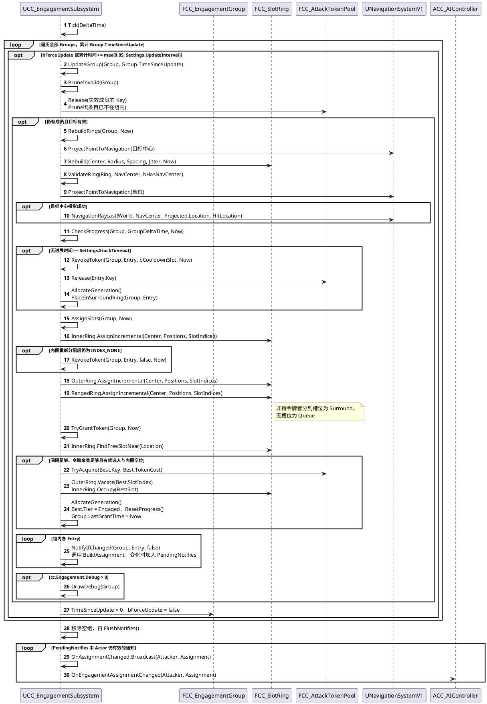

通知条件包括强制通知、首次通知、档位 / 编号 / 令牌状态 / 位置有效性改变，或位置相对**上次通知位置**移动超过 NotifyDistance。通知先排队，周期更新的广播发生在组遍历完成后。

### 7.3 发放令牌 → 移动 → 实际攻击 → 按标签归还

下面以 UCC_AttackIntend 派发近战为例。现有 BT 攻击任务也可以直接调用 UActionComponent::TryAttack；TryAttack 属于动作组件，不是 UCC_Primary 的方法。

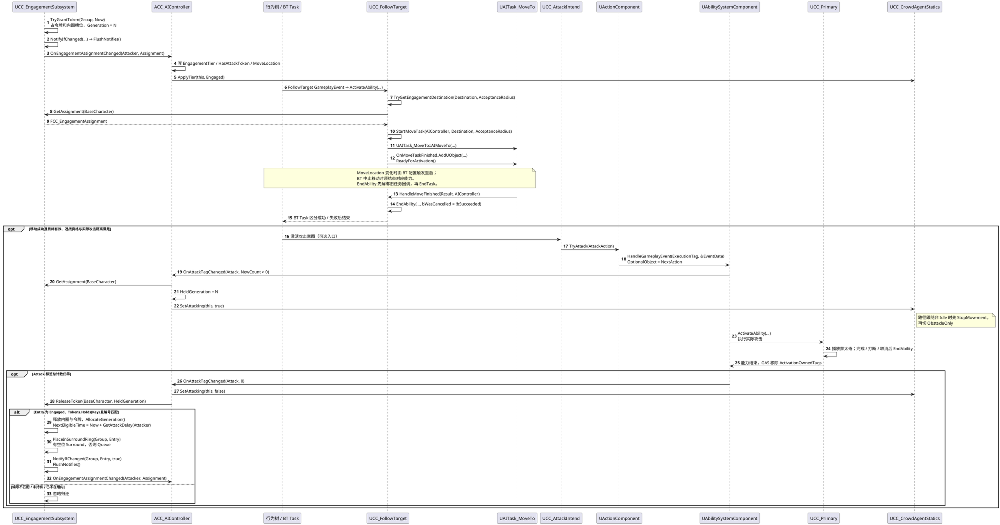

标签在 GAS 激活流程中授予，通知可能早于实际攻击能力的 ActivateAbility 正文。控制器监听的是 ASC 标签边界变化，不是蒙太奇完成委托；标签归零既可能来自正常结束，也可能来自取消、打断或激活失败后的结束。移动成功 / 失败如何映射到 BT Task 结果属于行为树接入要求，不能仅凭“能力结束”认定到达。

### 7.4 编号如何防止误释放

编号由 AllocateGeneration() 在整个子系统内分配。移除旧 Entry 不会先给这个 Entry 加一；新注册和新令牌各自获取新编号。当前 TryGrantToken 会跳过仍带 Attack 标签的成员，所以正常流程不会在旧攻击仍执行时给它再发一张令牌。

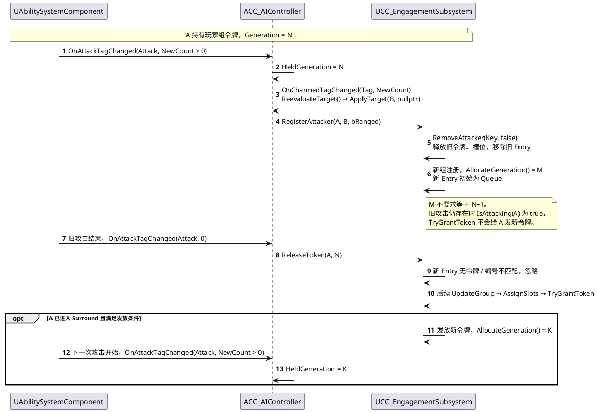

如果外部或延迟调用仍尝试 ReleaseToken(A, N)，即使此时 A 已持有编号 K 的令牌，也会被编号校验拒绝。

### 7.5 死亡、目标变化与异常回收

怪物死亡与控制器解除附身是两种事件，不保证死亡当帧就进入 OnUnPossess。HandleDeath 标记不存活后，组更新会兜底清理；Actor 已失效时仍释放占用，但不向该 Actor 广播退出通知。

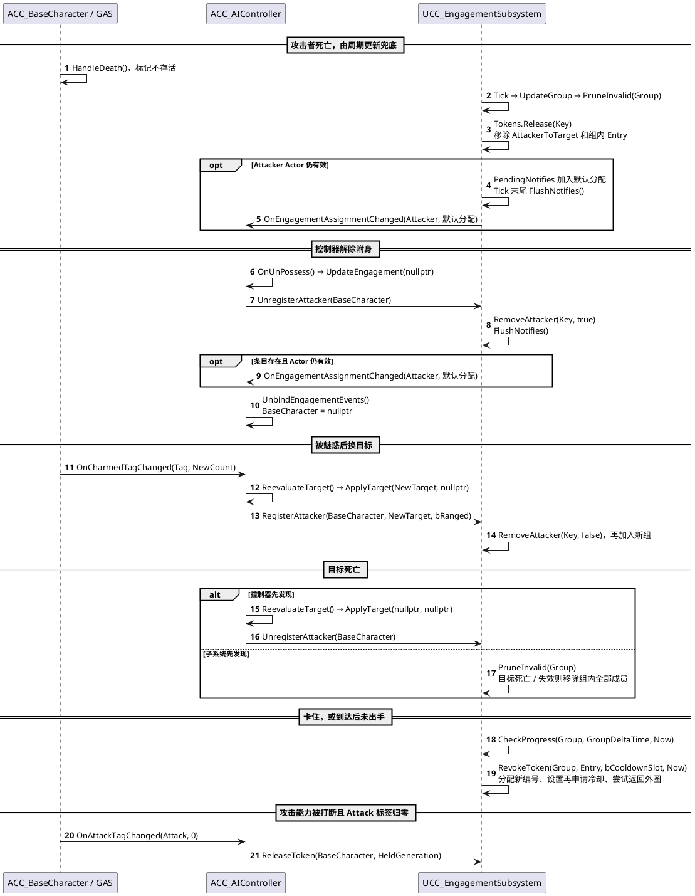

退出时的默认分配为 None / false / bLocationValid=false / Generation=0。后续补位只通知分配发生变化的存活成员，不是无条件向所有怪物发送一次“死亡事件”。OnAssignmentChanged 不能代替角色死亡通知。

### 7.6 Crowd 接入与玩家注册

ConfigureCrowdAgent、ApplyTier、SetAttacking 都属于 UCC_CrowdAgentStatics。玩家向 UCrowdManager 注册的对象是组件 this，不是玩家 Actor 或 AI 的 PathFollowingComponent。

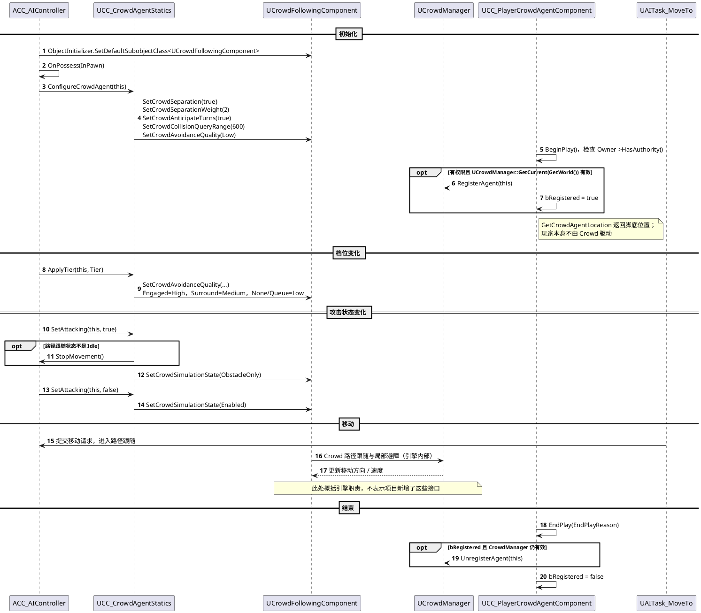

## 8. 增量槽位分配算法

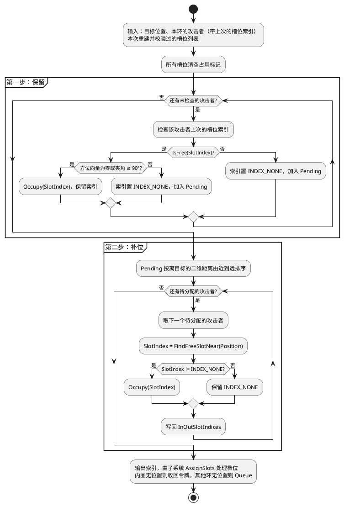

没有全局重排，也就不需要滞回参数。玩家移动时槽位随之平移，大多数人的槽位索引不变，只是位置跟着动。

## 9. 当前接入点与资产配置要求

下表的 C++ 接入按当前工作区核对；黑板、行为树和项目参数是接入要求，不表示这些资产已全部配置或通过运行验证。

| 文件 | 改动 |
|---|---|
| `AI/CC_AIController` | `OnPossess` 配置 Crowd 并绑定事件；`ApplyTarget` / `ReevaluateTarget` 调用 `UpdateEngagement`；`OnEngagementAssignmentChanged` 写黑板并调避障质量；`OnAttackTagChanged` 记录 / 校验编号；`OnUnPossess` 先注销再解绑 |
| `UCC_FollowTarget` | `TryGetEngagementDestination` 查询分配；`StartMoveTask` 创建 `UAITask_MoveTo`；`HandleMoveFinished` 区分成功 / 失败；`EndAbility` 解绑并结束旧任务；允许重新触发 |
| `UCC_Primary` | 构造函数 `ActivationOwnedTags.AddTag(CCTags::CCAbilities::Attack)` |
| `UCC_BowShoot` | 构造函数 `ActivationOwnedTags.AddTag(CCTags::CCAbilities::Attack)` |
| `ACC_ArrowProjectile` | 对 Pawn 通道改为重叠，在重叠回调里用 `IsHostile` 判断；友方穿过，敌方命中后销毁 |
| `ACC_PlayerCharacter` | 挂 `UCC_PlayerCrowdAgentComponent` |
| `ACC_EnemyCharacter` | 删除注释掉的 RVO 代码，避免误开导致与 Crowd 冲突 |
| `UCC_Dash` | 当前保留 Attack 激活阻断，攻击中不能冲刺；若要冲刺取消攻击，需同时设计能力取消策略，不能只删除阻断 |
| 黑板资产 | 新增键 `EngagementTier`（枚举）、`MoveLocation`（向量）、`HasAttackToken`（布尔） |
| 行为树资产 | Queue / Surround → FollowTarget 去分配位置（弓兵 Surround 时检查射程与冷却后射击）；Engaged → FollowTarget，移动成功且仍有攻击资格时才攻击；`MoveLocation` 监听放在移动节点上，中止 BT 移动任务时取消对应能力，移动失败不进入攻击 |
| 项目设置 | Crowd Manager 的 `MaxAgents` 调到敌人上限 + 余量，`MaxAgentRadius` 大于最大胶囊体半径 |

**职责边界**：攻击意图和实际攻击能力不申请 / 归还令牌；`UCC_KeepDistance` 仍只做过近后撤，不能替代近战外圈移动。黑板不存编号，编号在子系统条目、分配结果和控制器的 `HeldGeneration` 中保存。

**当前源码索引**（相对本文档所在目录）：

| 文件 | 核对内容 |
|---|---|
| [CC_EngagementSubsystem.h](../../Source/GAS_Demo/Public/AI/Engagement/CC_EngagementSubsystem.h) / [.cpp](../../Source/GAS_Demo/Private/AI/Engagement/CC_EngagementSubsystem.cpp) | 接口、更新顺序、发放 / 回收、通知 |
| [CC_EngagementTypes.h](../../Source/GAS_Demo/Public/AI/Engagement/CC_EngagementTypes.h) | 枚举、配置与分配结果 |
| [CC_EngagementGroup.h](../../Source/GAS_Demo/Public/AI/Engagement/CC_EngagementGroup.h) | 组、成员、进展与通知缓存 |
| [CC_SlotRing.h](../../Source/GAS_Demo/Public/AI/Engagement/Slots/CC_SlotRing.h) / [.cpp](../../Source/GAS_Demo/Private/AI/Engagement/Slots/CC_SlotRing.cpp) | 槽位生成、占用与增量分配 |
| [CC_AttackTokenPool.h](../../Source/GAS_Demo/Public/AI/Engagement/Tokens/CC_AttackTokenPool.h) | 纯逻辑令牌池 |
| [CC_AIController.h](../../Source/GAS_Demo/Public/AI/CC_AIController.h) / [.cpp](../../Source/GAS_Demo/Private/AI/CC_AIController.cpp) | 目标同步、事件绑定、黑板回调 |
| [CC_FollowTarget.cpp](../../Source/GAS_Demo/Private/AbilitySystem/Abilities/Logic/CC_FollowTarget.cpp) | 移动能力与任务生命周期 |
| [CC_AttackIntend.cpp](../../Source/GAS_Demo/Private/AbilitySystem/Abilities/Intent/CC_AttackIntend.cpp) / [ActionComponent.cpp](../../Source/GAS_Demo/Private/Components/ActionComponent.cpp) | 攻击意图到实际能力的派发 |
| [CC_CrowdAgentStatics.cpp](../../Source/GAS_Demo/Private/AI/Crowd/CC_CrowdAgentStatics.cpp) | Crowd 参数、档位与攻击状态切换 |
| [CC_PlayerCrowdAgentComponent.cpp](../../Source/GAS_Demo/Private/AI/Crowd/CC_PlayerCrowdAgentComponent.cpp) | 玩家组件注册 / 注销 |

## 10. 测试计划

当前 [CC_EngagementTests.cpp](../../Source/GAS_Demo/Private/Tests/CC_EngagementTests.cpp) 已定义两个自动化测试：`GAS_Demo.AI.Engagement.SlotRing` 和 `GAS_Demo.AI.Engagement.TokenPool`。本次仅核对文档，没有运行测试或编译项目。

已存在的纯逻辑测试：

- `FCC_SlotRing`：槽位数随半径和间距正确计算；增量分配保留有效旧槽位；夹角超过 90° 时重新分配；槽位不够时离得远的人降档；冷却中的槽位不被分配
- `FCC_AttackTokenPool`：容量与消耗值；重复申请幂等；释放后可再申请；`PruneIf` 清理失效持有者

尚需补充的子系统集成验证（不是已有自动化测试清单）：

- 内圈没有空闲可用槽位时不发放令牌（#1、#5）
- 旧编号的 `ReleaseToken` 不影响新令牌；未持有令牌时 `ReleaseToken` 无效果（#2、#9）
- 未到达且自身静止超时：收回 + 槽位冷却；目标快速移动时不计时；到达但未出手超时：收回、不冷却（#3、#13、#19）
- 同一组两次发放间隔不小于 `MinGrantInterval`，每次更新最多发一个（#6、#12）
- 归还后 `NextEligibleTime` 生效，期间不会再被选中
- 注册 / 注销；被魅惑后转组；目标死亡时整组清空

编辑器内手动验证：

- 刷 100 近战 + 20 弓兵，Unreal Insights 记录 Crowd、子系统、感知、动画各自的耗时
- 玩家贴墙、站在走廊、站在薄墙边：确认进场人数自动减少、没有怪被分到墙后
- 玩家绕圈跑：确认交战中的怪不会因为追不上被频繁收回令牌，也不会守着对面的槽位
- 弓兵在包围圈外射击：确认箭穿过友军命中玩家
- 使用已有 `cc.Engagement.Debug 1` 调试绘制，观察每组槽位和令牌持有者

## 11. 待确认的参数

| 参数 | 建议起始值 | 根据什么调整 |
|---|---|---|
| 令牌容量 | 4 | 战斗节奏，玩家能同时应付几个人 |
| `MinGrantInterval` | 0.4 秒 | 令牌发放的间隔；默认周期更新下通常约 0.5 秒，受强制更新与帧时序影响，不能保证实际攻击起手间隔 |
| `StuckTimeout` | 2 秒 | 地形复杂程度 |
| 槽位冷却 | 3 秒 | 同上 |
| `TargetFastSpeed` | 300 | 玩家跑步速度，略低于它 |
| `StuckSelfSpeed` | 50 | 判断「真的卡住」的速度阈值 |
| 内圈半径 | 近战攻击距离 + 胶囊体半径，约 180 | 敌人攻击范围 |
| 外圈半径 | 450 | 要有压迫感但不挡住内圈进出 |
| 槽位间距 | 2 × 最大胶囊体半径 + 40 | 敌人体型 |
| `QueueMargin` | 100 | 排队区与外圈的距离 |
| 更新间隔 | 0.25 秒 | 敌人数量和玩家移动速度 |

## 12. 后续可选改进（本版不做）

| 改进 | 解决什么 | 什么时候考虑 |
|---|---|---|
| 攻击后的「恢复」阶段 | 怪物轮流上场、内外圈来回移动太多 | 实测觉得节奏机械时 |
| 能力主动上报执行结果 | 比周期检查更快发现受阻 | 2 秒的卡住判定显得太慢时 |
| 跨组槽位冲突检查 | 玩家和随从站得近时两组外圈重叠 | 双目标混战经常拥堵时 |
| 弓兵齐射预算 | 远程同时齐射 | 弓兵数量多、玩家觉得不公平时 |
| 档位 / 兵种 / 更新策略完全拆成三个维度 | 近战远程两用的怪 | 出现这类敌人时 |

## 13. 实现时的细节调整

| 位置 | 文档原写法 | 实际实现 | 原因 |
|---|---|---|---|
| 子系统创建 | `ShouldCreateSubsystem` 判断 `NetMode != NM_Client` | 只判断 World 类型（Game / PIE） | 子系统创建时客户端的网络驱动可能还没就绪，NetMode 不可靠；客户端没有 AIController，不会有注册，Tick 立即返回 |
| 持令牌者的内圈槽位失效 | 直接收回令牌 | 先在内圈里换一个空闲可用槽位，没有才收回（不冷却） | 只是这个槽位不能用，不代表内圈没位置，换位比收回更平滑 |
| `CC_FollowTarget` | 只改 `bRetriggerInstancedAbility` | 同时新增 `EndAbility`：先解绑再结束旧的 `UAITask_MoveTo` | 否则旧任务被新的移动请求顶掉时，会回调到新激活的实例，把它也结束掉 |
| 攻击开始时切 `ObstacleOnly` | 直接切换 | 路径跟随不空闲时先 `StopMovement` 再切换 | 引擎只允许在路径跟随空闲时切换 Crowd 模拟状态 |
| 远程圈半径 | 「MinRange～MaxRange 之间」 | 第一个加入该组的弓兵的 (MinRange + MaxRange) / 2，且不小于外圈半径 + 槽位间距；组存在期间不变 | 半径不变才能保证槽位索引稳定 |
| 参数配置 | 未说明 | `UCC_EngagementSubsystem` 的 `Config` 属性，在 `DefaultGame.ini` 中覆盖 | 不新增设置类 |
| 调试 | 未说明 | 控制台变量 `cc.Engagement.Debug 1` 绘制槽位和令牌持有者 | 便于调参 |
| 注册自愈 | 只在 `ApplyTarget` 中注册 | 控制器按 `TargetReevaluateInterval`（默认 0.5 秒）调用 `ReevaluateTarget`，仍有目标时再次注册；同一目标时只同步兵种 | 子系统兜底清理后，若控制器的目标没变，`ApplyTarget` 不会再被调用 |
| 槽位校验函数 | `ValidateSlots(Group)` | `RebuildRings(Group, Now)` 内按环调用 `ValidateRing(Ring, NavCenter, bHasNavCenter)` | 实际代码没有 `ValidateSlots` 函数 |
| 分配通知 | 把 `OnAssignmentChanged()` 当作控制器函数 | 子系统 `NotifyIfChanged` 排队，`FlushNotifies` 调用 `OnAssignmentChanged.Broadcast`，控制器执行 `OnEngagementAssignmentChanged` | 委托、回调、订阅句柄是不同概念 |
| 分配编号 | `uint32`，每次变化写“旧值 +1” | `int32`，用 `AllocateGeneration` 分配子系统级序号；移除条目直接丢弃旧编号 | 其他成员也会分配编号，单个成员的编号不保证连续 |
| 空闲容量 | 持有数小于 `min(配置容量, 空闲槽位数)` | 对候选人检查 `Tokens.Available() >= TokenCost`，同时要求一个空闲可用内圈槽位 | 空闲槽位数不能作为总持有量上限；当前不会动态把令牌池容量改为空闲槽位数 |
| 周期更新 | “本帧只更新一批组” | 每帧遍历全部组，按各组累计时间或强制标记决定是否更新 | 当前没有固定的每帧工作预算 |
| 死亡退出通知 | 死亡必定立即触发回调 | 主动注销或 `PruneInvalid` 清理时通知；Actor 已失效则跳过广播 | 分配委托不是死亡委托，不能要求每条销毁路径都有回调 |
