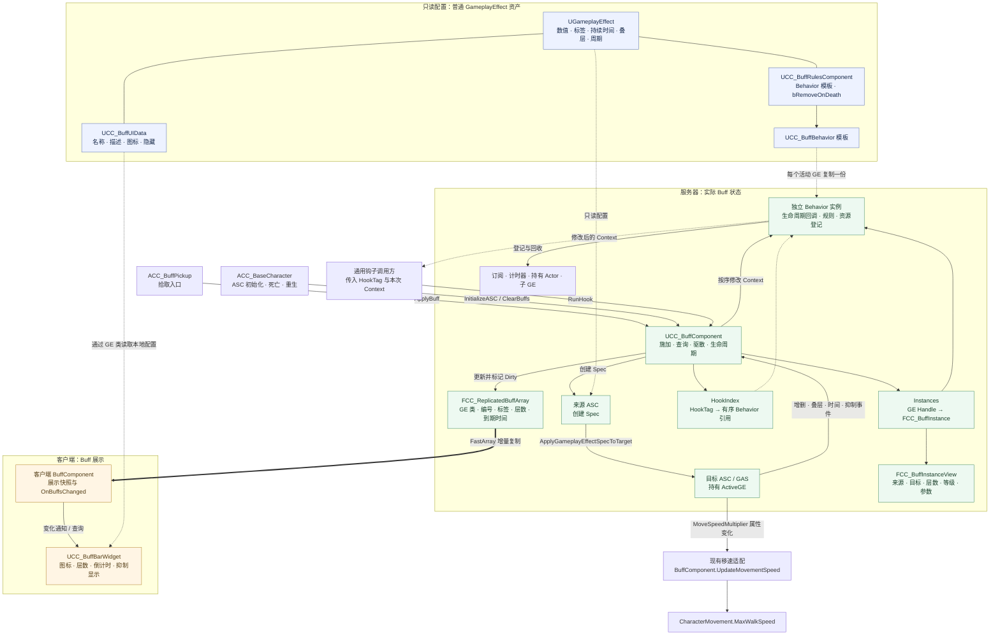
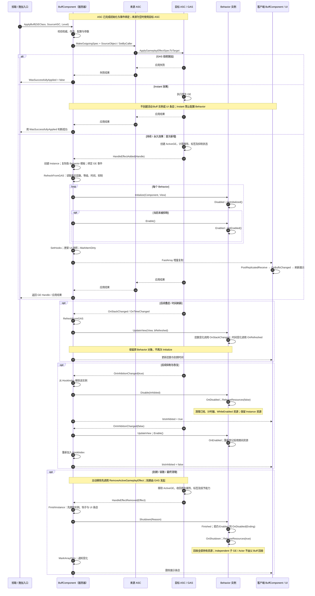
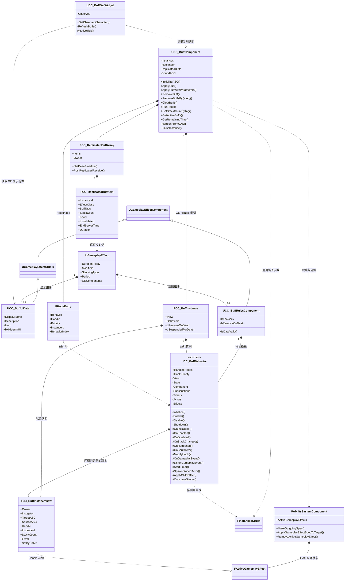

# Buff 系统结构图、序列图与类图

依据当前项目代码绘制；范围仅为已经实现的 Buff 核心。

配置使用普通 GameplayEffect，原生 GAS 负责属性、标签、持续时间、堆叠与周期。BuffComponent 观察活动 GE，管理独立 Behavior、通用钩子及 UI 快照。没有画入分裂箭、伤害管线、阵营、召唤等具体玩法扩展。

## 1. 结构图

蓝色为只读配置，绿色为服务器运行时，黄色为客户端显示。

注意：资源登记与回收实际位于 Behavior 基类中；没有另设 OwnedResources 管理类。移速倍率适配目前仍保留在 BuffComponent 内。通用 RunHook 已实现，当前没有接入具体战斗系统。

## 2. 序列图

图中“叠层、抑制、移除”是活动 GE 的后续路径，适用于持续或永久效果。

死亡清理有两条分支：
- bRemoveOnDeath=true：移除 GE，走最终清理。
- bRemoveOnDeath=false：保留 GE 和实例，设置 bSuspendedForDeath，移除钩子并 Disable(OwnerDeath)。重生时清理旧 Buff。

EndPlay 会清理并解绑 ASC，组件结束时不再主动发出展示变化通知。WhileEnabled 资源在抑制时回收；Instance 资源在最终结束时回收；Independent 资源自行结束。拥有型子 GE 要求 Stacking=None。

## 3. 类图

同名 Behavior 类型有两种对象：GE 规则组件里的只读模板，以及 BuffComponent 下的运行实例。两者不能共用实例状态。

类图展示主要字段与方法，省略引擎通用成员、委托类型及部分内部辅助函数。HookIndex 按 HookPriority、InstanceId、BehaviorIndex 排序。实际复制的只有 FCC_ReplicatedBuffArray，Behavior、实例表与 GAS Handle 不复制给 UI。

