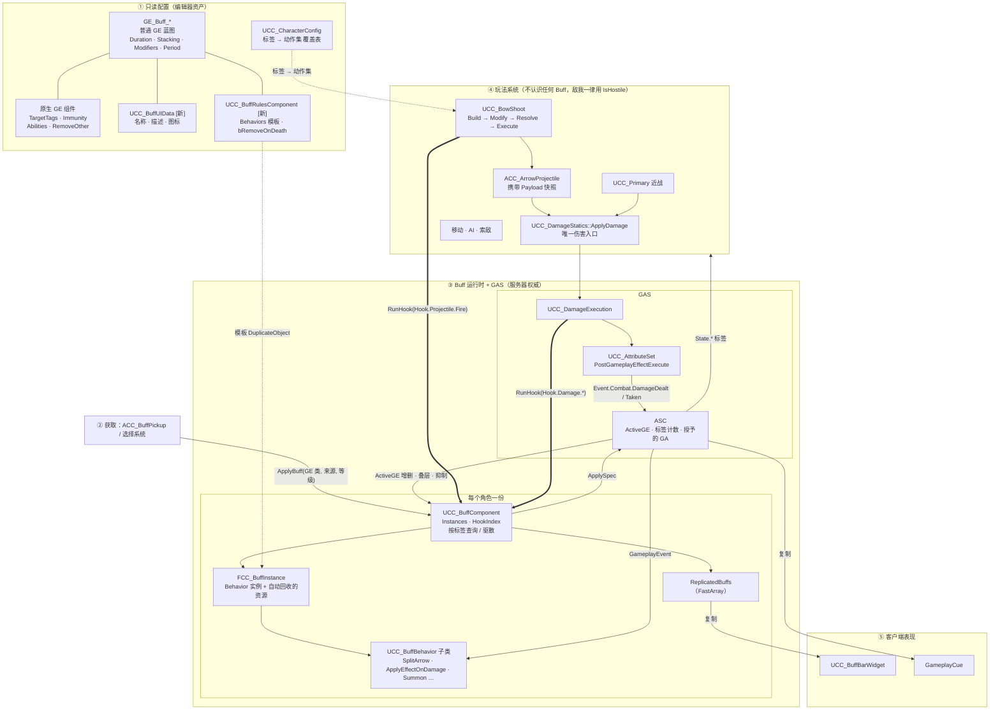
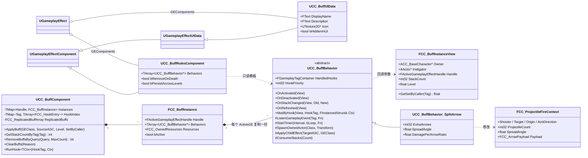
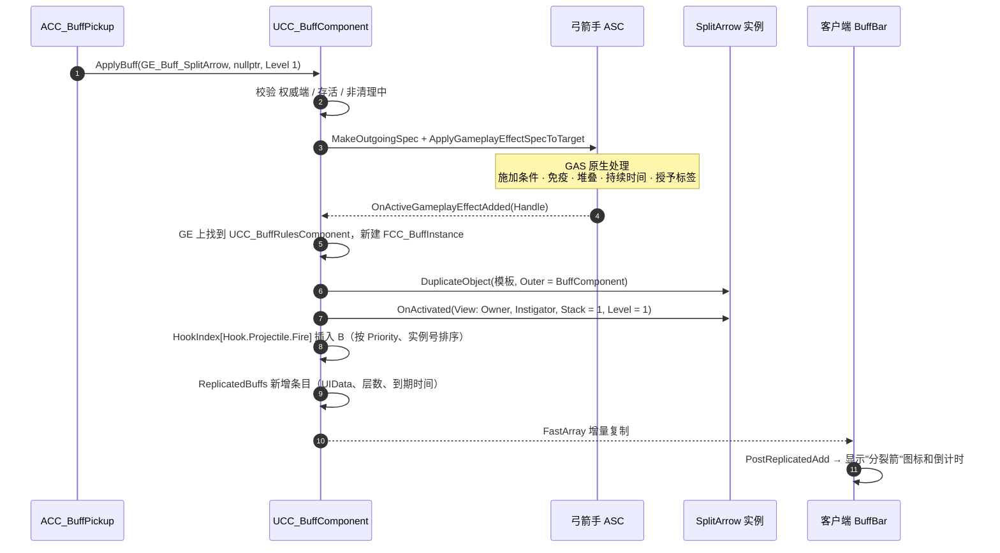
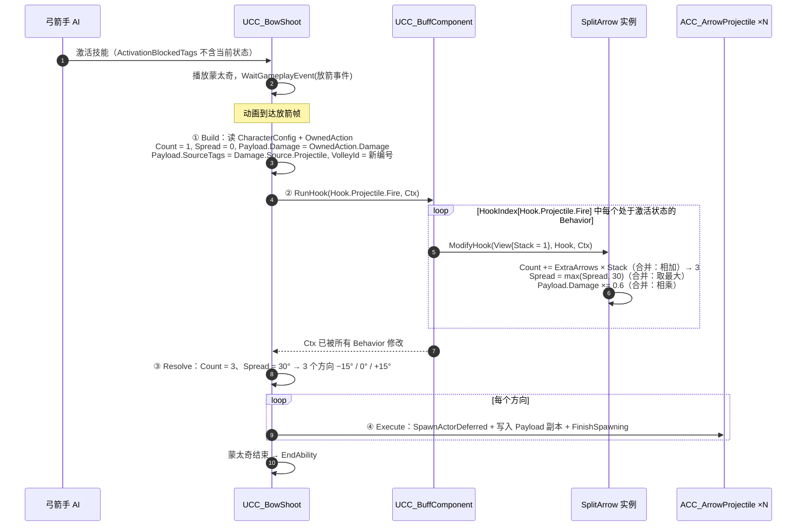
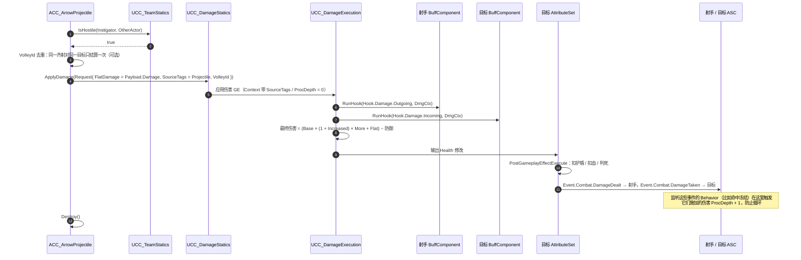
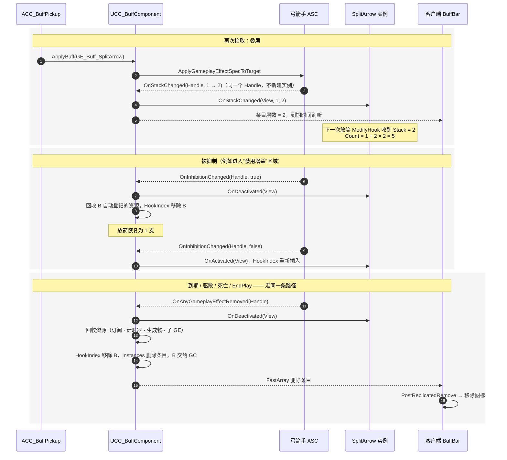

# Buff 系统架构

本文描述 Buff 系统重构后的**目标结构**。原则见 `BuffSystem.zh-CN.md`，案例见 `BuffSystem-Cookbook.zh-CN.md`，当前代码离目标还差什么见 `BuffSystem-Roadmap.zh-CN.md`。

图中标注 `[新]` 的类型尚未实现。

## 1. 架构总览

依赖方向只有一条：**Buff → 标签 / 属性 / 钩子上下文 ← 系统**。粗箭头是钩子调用（系统 → BuffComponent），图中的"玩法系统"不引用任何具体 Buff。

### 各部分职责

| 部分 | 负责 | 不负责 |
|---|---|---|
| GE 资产 | 数值、标签、免疫、堆叠、持续时间、周期 | 任何运行时状态 |
| `UCC_BuffUIData` | 显示信息 | 玩法 |
| `UCC_BuffRulesComponent` | 声明这个 Buff 挂哪些 Behavior、死亡是否移除 | 保存实例数据（它是共享模板） |
| `UCC_BuffComponent` | 实例表、钩子分发、UI 复制、按标签查询和驱散 | 召唤、动作集、移速等具体玩法 |
| `UCC_BuffBehavior` | 规则层逻辑：改上下文、监听事件、管理自己创建的资源 | 判断别的 Buff 是否存在 |
| 玩法系统 | 在决策点构造上下文、调用 `RunHook`、按结果执行 | 判断具体 Buff |

## 2. 核心类关系

### 三种 Context 不要混用

| 名字 | 是什么 | 生命周期 |
|---|---|---|
| `FCC_BuffInstanceView` | "这一份 Buff"的只读信息，传给 Behavior | 跟着 ActiveGE |
| `FCC_*HookContext` / `FCC_ProjectileFireContext` | 某个决策点"这一次"的可修改参数 | 一次 `RunHook` 调用 |
| `FCC_GameplayEffectContext` | 随 GE 传递的来源信息：`SourceTags`、`ProcDepth`、`ProcChainMask`、`VolleyId` | 一次伤害 / 一次施加 |

## 3. 时序：弓箭手获得分裂箭之后

示例配置：

- `GE_Buff_SplitArrow`：持续 20 秒，按来源叠加，最多 3 层，重复施加刷新持续时间。
- `UCC_BuffUIData`：名称"分裂箭"。
- `UCC_BuffRulesComponent.Behaviors = [ UCC_BuffBehavior_SplitArrow { ExtraArrows = 2, SpreadAngle = 30, DamagePerArrowRatio = 0.6 } ]`，`HandledHooks = Hook.Projectile.Fire`。

以下除"客户端"一列外都在服务器执行。

### 3.1 获得 Buff

### 3.2 放箭：Build → Modify → Resolve → Execute

`UCC_BowShoot` 全程不知道分裂箭存在，它只知道"放箭这一步有个钩子"。

如果同时还有爆炸箭，它也挂在 `Hook.Projectile.Fire` 上，在同一个循环里把 `Payload.ExplosionRadius` 写进去。结果就是"3 支会爆炸的箭"，两个 Behavior 互相不知道对方。

### 3.3 命中：只用 Payload，不回头查射手

箭飞行途中分裂箭到期、甚至射手死亡，都不影响已发射的箭，因为它命中时只读自己的 Payload。

### 3.4 叠层、抑制与结束

### 生命周期对照（设计原则第 9 节）

| 路径 | 触发 | BuffComponent 做什么 |
|---|---|---|
| 正常到期 | `OnAnyGameplayEffectRemoved` | `OnDeactivated` → 回收 → 删实例 |
| 驱散 / 主动移除 | `RemoveBuffsByQuery` → GAS 移除 → 同上 | 同上 |
| 抑制 / 恢复 | `OnInhibitionChanged` | `OnDeactivated` / `OnActivated`，保留实例 |
| 叠层增减 | `OnStackChanged` | `OnStackChanged`，不重建实例 |
| 持有者死亡 | `ClearBuffs(Death)`，只移除 `bRemoveOnDeath` 的 | 同"到期" |
| 关卡切换 / EndPlay | `ClearBuffs(EndPlay)` | 同"到期" |
| 放箭过程中被移除 | — | 下一次 `RunHook` 生效；已发射的箭不受影响（快照） |
