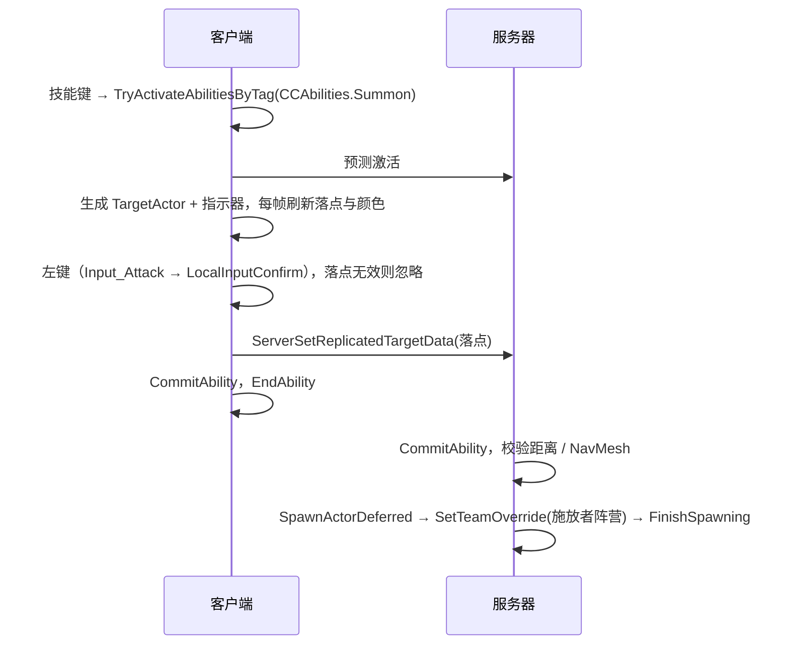

# 选点召唤随从（UCC_SummonAlly）

玩家按技能键 → 鼠标所指地面出现高亮圈（绿 = 可放置，红 = 不可放置）→ 左键确认 → 在该处生成一个与玩家**同阵营**的 `ACC_EnemyCharacter`。

## 1. 组成

| 类 | 职责 |
|---|---|
| `UCC_SummonAlly`（GA） | 激活后开 `WaitTargetData`（UserConfirmed）；确认时提交冷却/消耗；服务器校验距离和 NavMesh 后生成随从，并维护数量上限与存在时间 |
| `ACC_TargetActor_GroundPlacement` | 通用"鼠标地面选点"Target Actor，只在本地客户端存在。鼠标射线打地面，超出范围时拉回边缘；检查坡度、胶囊空间，有导航数据时检查 NavMesh |
| `ACC_GroundPlacementIndicator` | 地面高亮圈。配置贴花材质则用贴花，否则用引擎自带扁圆盘（零资产可用）。颜色通过材质 Vector 参数 `Color` 切换 |
| `ACC_BaseCharacter::SetTeamOverride` | 实例级阵营覆盖（复制）。`UCC_TeamStatics` 优先读取它，所以敌我判断、AI 选目标、箭的命中、击杀经验全部自动生效 |
| `ACC_PlayerController` | 绑定 `InputConfig.AbilityInputActions`（按 InputTag 激活能力）；`CCTags.Status.Targeting` 期间攻击键 = 确认、技能键 = 取消 |

## 2. 时序

取消：右键、Esc，或再按一次技能键。取消不扣冷却。

## 3. 编辑器接入

1. **能力蓝图**：新建蓝图，父类 `CC_SummonAlly`，例如 `GA_SummonAlly`。
   - `Summon Class`：要召唤的敌人蓝图（如现有的 Boris / Grux 敌人蓝图）。**不需要改那个蓝图的 CharacterConfig.Team**。
   - `Max Range`（默认 1200）、`Max Active Summons`（默认 3，超出销毁最早的）、`Summon Life Span`（0 = 永久）。
   - 需要单独数值时勾 `Override Spawn Params`，填初始化 GE / 等级 / 血量倍率。
   - 冷却和消耗：照常填 GAS 的 `Cooldown Gameplay Effect Class` / `Cost Gameplay Effect Class`。
2. **授予**：把 `GA_SummonAlly` 加到玩家 CharacterConfig 的 `StartupAbilities`；或者由 Buff 的 Grant Abilities 组件授予（Buff 移除时能力被移除，默认会销毁该能力召唤的全部随从）。
3. **输入**：
   - 新建 `IA_Summon`（Digital），在玩家的 IMC 里映射一个键（如 `Q`）。
   - 在 PlayerController 引用的 `InputConfig` 资产里，`Ability Input Actions` 新增一项：Input Action = `IA_Summon`，Input Tag = `CCTags.CCAbilities.Summon`。
   - 确认键沿用现有攻击键，不需要额外配置。
4. **高亮效果（可选）**：默认是绿/红扁圆盘。想要贴地光圈：
   - 建一个材质，Material Domain = `Deferred Decal`，Blend Mode = Translucent，加一个 Vector 参数 `Color` 接 Emissive / Base Color，用一张圆环贴图做 Opacity。
   - 新建蓝图继承 `CC_GroundPlacementIndicator`，填 `Decal Material`、`Valid Color`、`Invalid Color`，再把它填到能力的 `Indicator Class`。
   - 更多表现（粒子、缩放动画）在指示器蓝图里实现 `On Placement Validity Changed`。
5. **地面检测**：默认只打 `WorldStatic`。如果地面是别的对象类型，新建蓝图继承 `CC_TargetActor_GroundPlacement`，改 `Ground Object Types`，填到能力的 `Target Actor Class`。

## 4. 规则与限制

- 服务器不信任客户端落点：超出 `MaxRange + RangeTolerance`、投影不到 NavMesh、生成点被占用都会拒绝（日志 `[Summon] Rejected`），此时冷却已扣。
- 客户端一般没有导航数据，显示为绿色的点在服务器上仍可能因不在 NavMesh 上被拒；NavMesh 覆盖完整的场景不会遇到。
- 随从是普通的 `ACC_EnemyCharacter`，复用敌人的 AI：看到敌对目标就打，**没有敌人时原地待命，不会跟随玩家**。跟随 / 坚守等命令属于 `AI-Combat.zh-CN.md` 预留的编队层，尚未实现。
- 随从被敌人杀死不给经验（`ShouldCreditKill` 走 `IsHostile`）；随从击杀敌人算玩家方击杀，给团队经验。
- 玩家死亡时随从不消失；需要时再加。
- 只支持有 PlayerController 的施放者；AI 召唤需要另写不经过鼠标选点的版本，可直接调用 `SpawnSummon`。

## 5. 测试

- `GAS_Demo.Team.InstanceOverride`：同一敌人类的两个实例站不同阵营、覆盖与魅惑叠加、清除覆盖后恢复。
- 实机：PIE 选 Listen Server + 1 Client，两端分别召唤，确认客户端也能看到高亮、随从攻击敌人而不攻击玩家。
