# 生存模式（波次刷怪 + 共享经验 + 倒计时复活）设计

状态：**设计稿 v2，尚未实现**。实现时以本文档为准；有偏差先改文档。

玩法：地图按波次定时刷怪，怪物属性随波次变强；全队共享经验，升级时每个玩家各自 Buff 三选一；玩家阵亡后倒计时复活在存活队友身边；全员阵亡则游戏结束，结算击杀数。

v2 相对 v1 的变化见第 15 节。

## 1. 规则

### 1.1 已确认

| 规则 | 结论 |
|---|---|
| 经验 | **全队共享**一条经验和等级；每升一级，**每个玩家**各得一轮三选一 |
| 阵亡 | 倒计时复活，复活点在**随机一名存活队友**身边 |
| 游戏结束 | **全员同时处于阵亡状态**即结束；单机下即"死亡即结束" |
| 击杀统计 | 个人统计（PlayerState）+ 全队统计（GameState），结算都显示 |
| 刷怪节奏 | 定时推进波次；可选"清场提前进入下一波" |
| 怪物成长 | 分档初始化 GE（质变）+ GE Level = 波次（档内平滑成长） |

### 1.2 待确认（已给默认值，实现时按默认值做，可随时改配置）

| 问题 | 默认方案 | 说明 |
|---|---|---|
| 联机时三选一不暂停，选卡期间挨打 | 选卡界面打开期间施加 `GE_ChoosingProtection`（默认减伤 50%，可配成无敌或关闭） | 单机会暂停世界，不受影响 |
| 人数越多越简单 | 怪物**数量**和**血量**按存活人数缩放（曲线配置，1 人 = 1.0） | 第 5.3 节 |
| 中途加入 | 遵循房主的 `bAllowJoinInProgress`；允许时：在队友身边出生，补发 `TeamLevel - 1` 轮三选一 | 现有 `ACC_RoomGameMode::PreLogin` 已按该选项拒绝 |
| 断线重连 | v1 不保留进度，重连按中途加入处理 | Buff 在 ASC 上，`AGameMode` 的 InactivePlayerState 也不会复制 ASC 状态 |

## 2. 现有代码的关键事实（设计依据）

| 事实 | 位置 | 对设计的影响 |
|---|---|---|
| 联机战斗 GameMode 的基类是 `ACC_RoomGameMode`（`AGameModeBase`），负责准入、无缝切图、`ReturnToLobby` | `Game/CC_RoomFramework` | `ACC_SurvivalGameMode` **继承它**；返回大厅直接复用 |
| 中途加入由房主选项 `bAllowJoinInProgress` 控制 | `ACC_RoomGameMode::CanAcceptPlayer` | 生存模式只需处理"允许加入"时的追赶 |
| 房间 PlayerState 是 `ACC_RoomPlayerState`，`CopyProperties` 在无缝切图时复制业务数据 | 同上 | 生存 PlayerState 继承它；**本局统计不跨局复制** |
| 三选一已完整实现，自带排队；无存活角色时返回 `NoTarget` 且本轮保留 | `UCC_BuffSelectionComponent` | 升级只需调用 `OfferBuffs(Pool)` |
| 刷怪器使用 `SpawnActorDeferred` | `ACC_EnemySpawner::SpawnEnemies` | 可在 `FinishSpawning` 前写入本波参数 |
| 刷怪器"不保证候选点位于可达导航区域" | `Docs/EnemySpawner.zh-CN.md` | 波次刷怪需加导航投影 |
| 属性初始化固定读 `CharacterConfig->InitializeAttributesEffect`，Level 1 | `ACC_BaseCharacter::InitializeAttributes` | 增加实例级覆盖；旧 GE 是常数时 Level 不影响 |
| `HandleDeath` 由 Health 变化回调触发，**拿不到击杀者**，也**无防重入** | `ACC_BaseCharacter::OnHealthChange` | 改为 AttributeSet 的"生命耗尽"事件（第 7.1 节） |
| 玩家 ASC 在 PlayerState，换 Pawn 不丢 GE；`UCC_BuffComponent` 在 Pawn 上 | `ACC_PlayerState` / `ACC_BaseCharacter` | 复活**复用原 Pawn**（第 13 节对照 Lyra 的取舍） |
| 死亡时 `bRemoveOnDeath=false` 的 Buff 只挂起（`bSuspendedForDeath`），**没有恢复入口** | `UCC_BuffComponent::ClearBuffs` | 新增 `ResumeAfterRevive()` |
| `HandleRespawn()` 调 `ClearBuffs()`（Reset）清空**全部** Buff | `ACC_BaseCharacter::HandleRespawn` | 复活**不能**走 `PossessedBy → HandleRespawn` |
| 已有 `CCTags.Status.Invincible`、`Status.Death` | `CC_Tags.h` | 复活保护复用 Invincible；需确认伤害 GE 已按它拒绝施加 |
| 包围系统已在目标 `!IsAlive()` 时释放槽位和令牌 | `CC_EngagementSubsystem.cpp` | 阵亡玩家不会被包围；寻敌选择是否跳过阵亡者仍需确认 |
| 已启用 `ModularGameplay` 插件、Iris 复制 | `.uproject` / `Build.cs` | 可用 `UGameStateComponent`；复制写法与项目一致 |
| UI 采用 View / Controller / Model，HUD 为 `CC_CombatMainController → Model → Widget` | `Docs/UIArchitecture.zh-CN.md` | 生存 HUD 扩展该 Controller/Model，Widget 不直接读 GameState |
| 引擎版本 5.6 | `.uproject` | 可用 `ULocalPlayerSaveGame` 做本地纪录 |

## 3. 模块划分与依赖

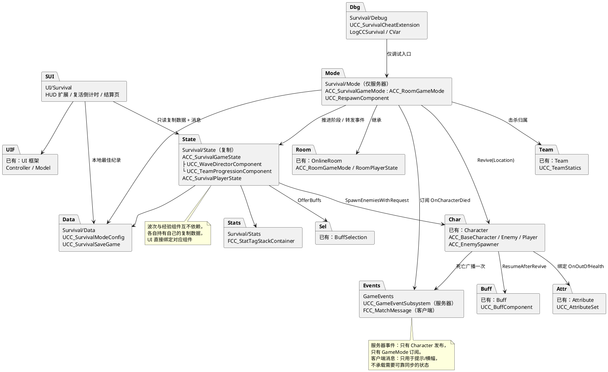

禁止的依赖：波次 ↔ 经验 ↔ 复活组件互相调用；`Character` → `Survival/*`（角色不知道自己处于生存模式）；UI → 任何服务器逻辑（只读复制数据）；任何 Survival 代码出现针对具体 Buff 的判断（硬性规则 1）；调试扩展以外的代码依赖 `Debug`。

**为什么波次与经验放在 GameState 组件上**：两者都有需要复制给所有客户端的状态（波次、倒计时、等级、经验条）。做成 `UGameStateComponent` 后，逻辑和它的复制数据放在同一个类里，服务器逻辑用 `HasAuthority()` 保护，GameState 本身不会膨胀成大杂烩。这也是 Lyra 的做法（模式功能以组件挂到 GameState 上）。复活只有服务器逻辑，个人倒计时在 PlayerState 上，所以留在 GameMode。

## 4. 总体架构（服务器 / 客户端）

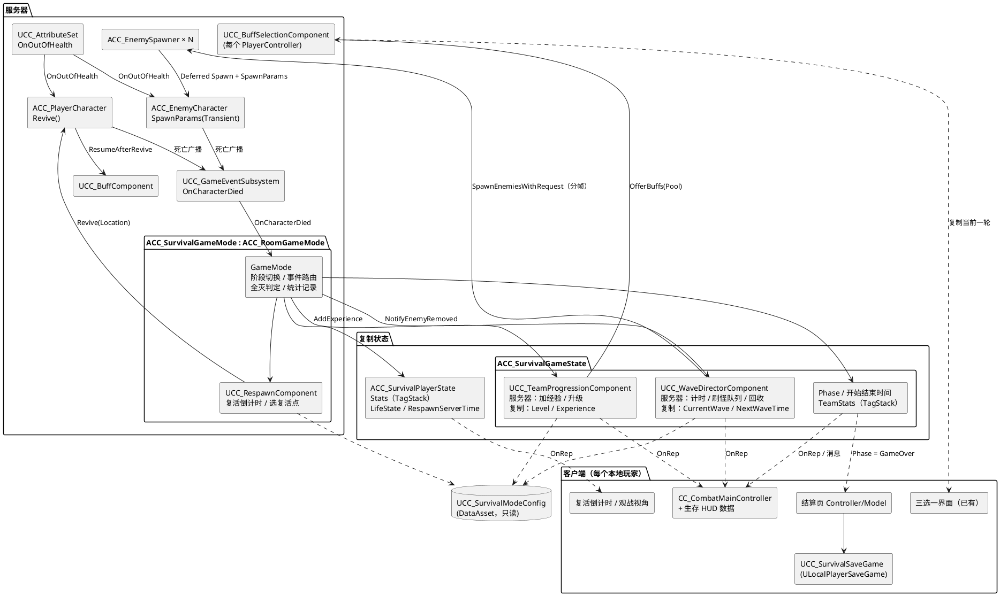

## 5. 类与数据

### 5.1 类图（新增与修改）

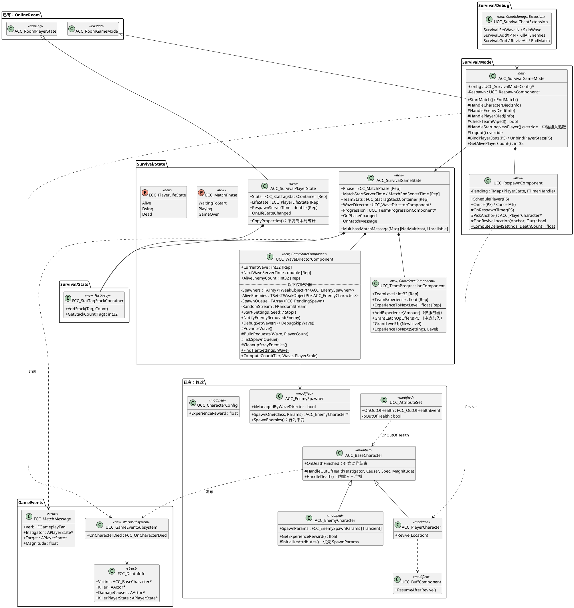

### 5.2 配置数据

全部是只读配置（硬性规则 6）。`ACC_SurvivalGameMode` 类默认值引用 `DA_SurvivalMode`；地图可在 URL 选项 `?SurvivalConfig=` 覆盖，用于不同地图不同难度。

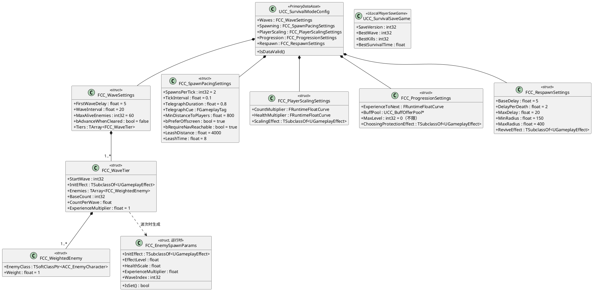

### 5.3 数值来源

- **怪物成长**：`InitEffect` 修正器使用 ScalableFloat，Curve 指向 CurveTable 行（如 `EnemyHealth_T2`），横轴为 GE Level = 波次。CurveTable 从 CSV 导入，策划可在表格软件里调整。
- **人数缩放**：数量 = `ComputeCount × CountMultiplier(存活人数)`；血量在 `InitEffect` 之后再施加 `ScalingEffect`，用 SetByCaller `Data.Survival.HealthScale` 乘 MaxHealth 并回满 Health。存活人数在**每波开始时**取样，波中有人阵亡不回调已刷出的怪。
- **经验**：怪物奖励 = `CharacterConfig.ExperienceReward × ExperienceMultiplier`。不按人数缩放（全队共享已经天然平衡）。
- **怪物类引用用软引用**：`TSoftClassPtr`，`Start()` 时异步预加载当前档和下一档，避免首次刷新时同步加载卡顿。

### 5.4 统计项（TagStack）

参考 Lyra 的 PlayerState `StatTags`：统计用"标签 → 计数"的 FastArray 容器，新增统计不改数据结构，结算页遍历显示。

| 标签 | 个人 | 全队 | 来源 |
|---|---|---|---|
| `Survival.Stat.Kills` | ✓ | ✓ | 死亡事件，击杀归属 |
| `Survival.Stat.Deaths` | ✓ | ✓ | 玩家死亡 |
| `Survival.Stat.Revives` | ✓ |  | 复活完成 |
| `Survival.Stat.DamageDealt` | ✓ | ✓ | 监听玩家 ASC 的 `Event.Combat.DamageDealt`（取整累计） |
| `Survival.Stat.DamageTaken` | ✓ |  | 监听 `Event.Combat.DamageTaken` |
| `Survival.Stat.BuffsChosen` | ✓ |  | 三选一 `Accepted` |

GameMode 在玩家加入时订阅其 ASC 的伤害事件，`Logout` 和 `EndMatch` 时退订（与订阅对称）。

## 6. 状态机

### 6.1 对局阶段（`ACC_SurvivalGameState::Phase`）

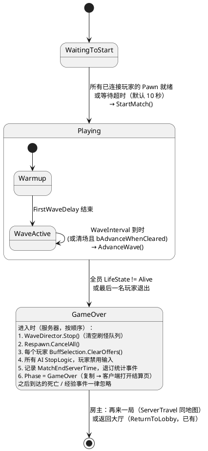

未采用的方案：`AGameMode` 的 `MatchState`（ShooterGame / UT 的做法）。因为 `ACC_RoomGameMode` 继承的是 `AGameModeBase`，换基类会影响大厅流程；Lyra 也是在 `GameModeBase` 上自建阶段。Lyra 用"阶段 = 一个 GameplayAbility"的阶段子系统，适合阶段多且嵌套的模式；本模式只有三个阶段，用枚举即可，以后阶段变多再迁移。

### 6.2 玩家生命状态（`ACC_SurvivalPlayerState::LifeState`）

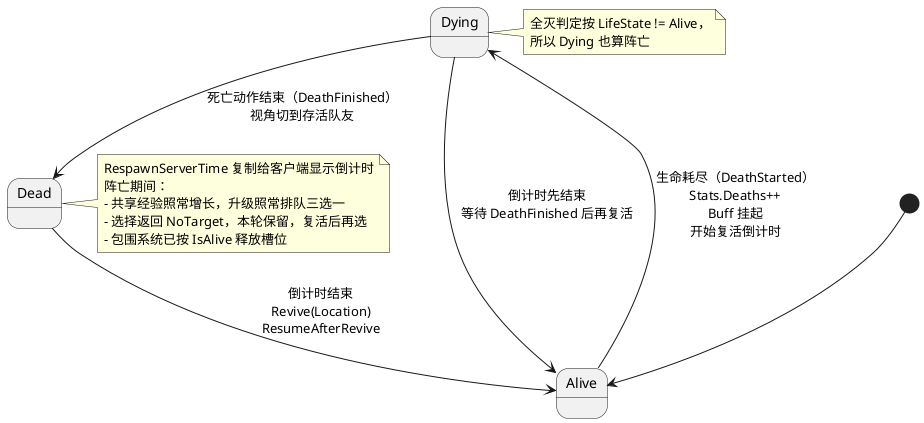

死亡分 Started / Finished 两段，参考 Lyra 的 `ULyraHealthComponent`：击杀统计、经验、全灭判定都在 **Started** 立即执行；尸体处理、视角切换、复活传送等**依赖动作结束**的事放在 **Finished**。

## 7. 时序图

### 7.1 死亡事件与击杀归属（地基）

参考 Lyra `ULyraHealthSet`：AttributeSet 在生命归零的那一次 GE 执行里直接广播"生命耗尽"，带上 Instigator / Causer / Spec。这比"扣血前记录来源、再由 Health 变化回调取用"更直接，也不依赖回调顺序。

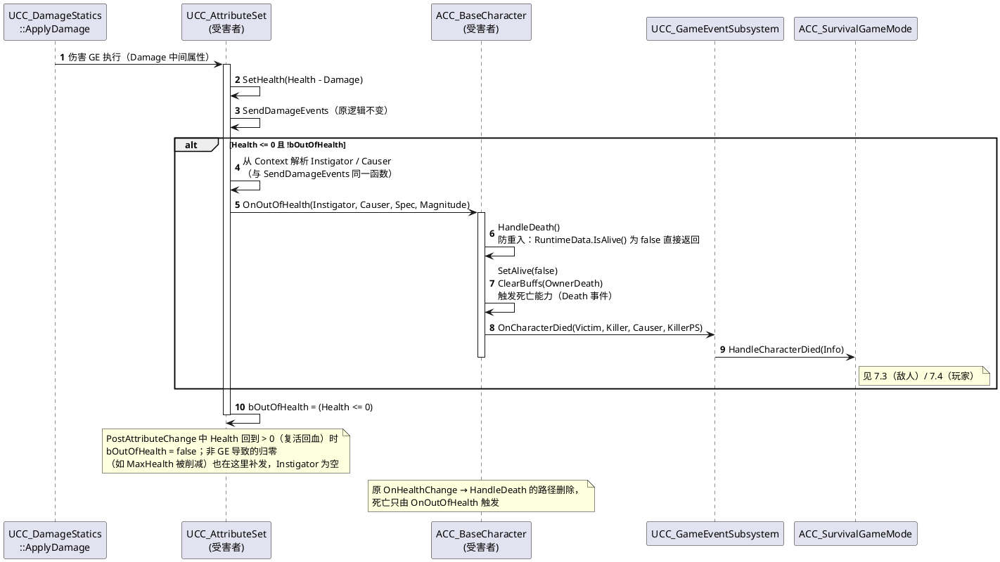

### 7.2 波次刷怪（分帧队列 + 出生预警）

一次在同一帧生成十几个 Character 会明显卡顿（每个都要初始化 ASC、授予能力、注册 Crowd）。成熟的生存类游戏都会把一波拆成队列分帧生成，并在出生点先播 0.5～1 秒的预警特效，既平滑开销，也让玩家有反应时间。

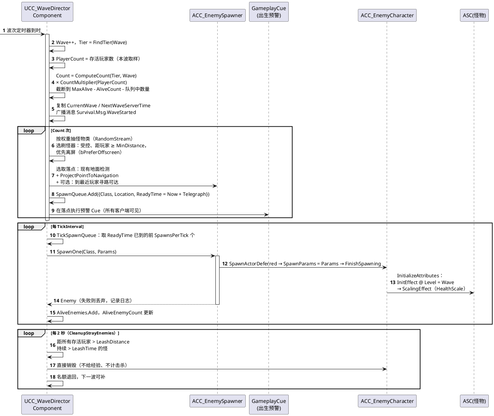

### 7.3 敌人阵亡：击杀统计与共享经验

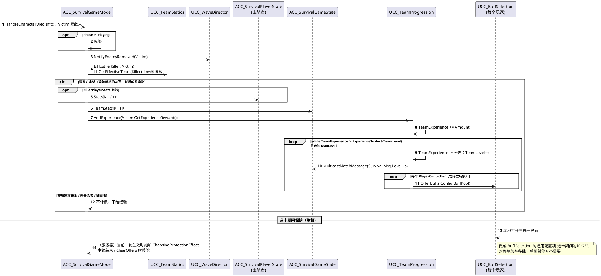

### 7.4 玩家阵亡、倒计时复活、全灭结束

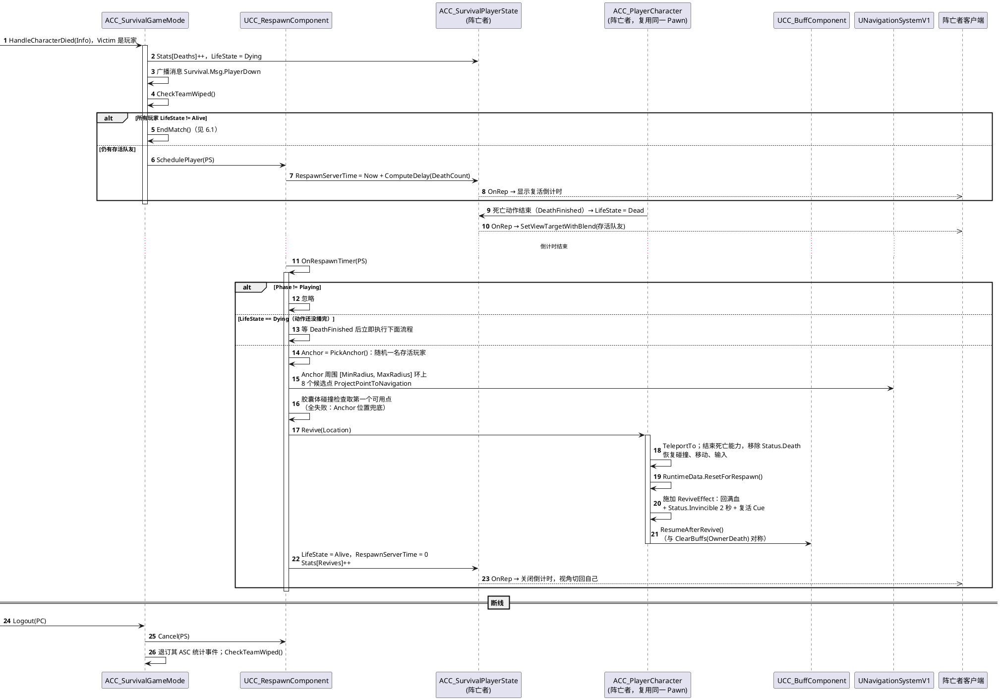

### 7.5 结算、纪录与再来一局

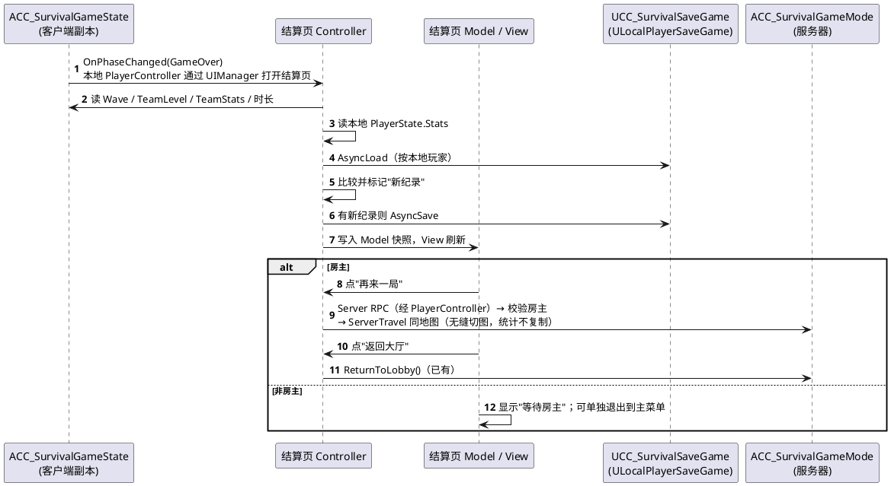

## 8. 网络与复制

| 数据 | 所在 | 复制方式 | 说明 |
|---|---|---|---|
| Phase、开始/结束时间 | GameState | 属性 + OnRep | 时间用 `GetServerWorldTimeSeconds` 基准，客户端自行算倒计时，不每秒复制 |
| CurrentWave、NextWaveServerTime、AliveEnemyCount | WaveDirector 组件 | 属性 + OnRep | AliveEnemyCount 仅用于 HUD，变化频繁时可限频 |
| TeamLevel、TeamExperience | Progression 组件 | 属性 + OnRep | |
| Stats | PlayerState / GameState | FastArray | 增量复制 |
| LifeState、RespawnServerTime | PlayerState | 属性 + OnRep | |
| 横幅、提示类消息 | GameState | NetMulticast **Unreliable** | 丢了不影响正确性；需要可靠的状态一律走属性 |
| 出生预警 | GameplayCue | 由 Cue 系统复制 | |

不做客户端预测：所有玩法判定只在服务器；客户端只显示。

## 9. 调试与调参工具

成熟项目都会为玩法模式配套作弊命令和可视化调试，否则调波次和复活要反复打很久。

| 工具 | 内容 |
|---|---|
| 作弊命令（`UCC_SurvivalCheatExtension`，只在非 Shipping） | `Survival.SetWave N`、`Survival.SkipWave`、`Survival.AddXP N`、`Survival.KillAllEnemies`、`Survival.God`、`Survival.ReviveAll`、`Survival.EndMatch`；客户端输入时经 Server RPC 转发 |
| 日志分类 | `LogCCSurvival`：阶段切换、每波数量与档位、击杀归属、复活点选择；Verbose 打印每只怪的 SpawnParams |
| 屏幕调试 | `cc.Survival.Debug 1`：显示当前波、档位、存活数、队列长度、下一波倒计时、各玩家复活倒计时 |
| 调参 CVar | `cc.Survival.WaveIntervalScale`、`cc.Survival.SpawnCountScale`、`cc.Survival.XPScale`，只在开发构建生效，不写回配置 |
| 随机种子 | 每局生成种子写入日志；`?SurvivalSeed=` 可复现同一局的抽怪顺序 |
| 平衡数据 | 每波结束追加一行 CSV 到 `Saved/Survival/`：波次、人数、刷出数、击杀数、承伤、阵亡数、清场用时，用于画难度曲线 |

## 10. 性能预算

| 项 | v1 做法 | 以后需要时 |
|---|---|---|
| 同帧生成开销 | 分帧队列 | 对象池（复用 Character，重置 ASC 和 RuntimeData） |
| 场上数量 | `MaxAliveEnemies` 硬上限，默认 60 | Significance Manager 按距离降级 |
| 动画 | 引擎默认 | Animation Budget Allocator / URO |
| 网络 | Iris 默认 | 远处怪物降低复制频率 |
| 资源加载 | 软引用 + 预加载当前档和下一档 | |

## 11. 硬性规则对照

| 规则 | 本设计如何满足 |
|---|---|
| 1 Buff 只声明状态 | Survival 代码不认识任何 Buff；升级只调 `OfferBuffs(Pool)`；"经验 +20%"以后做成属性，由 Progression 读属性 |
| 2 Definition 不加玩法字段 | `ExperienceReward` 加在 `UCC_CharacterConfig`（角色配置），不是 Buff 定义 |
| 3 伤害走 ApplyDamage | 不新增伤害路径；击杀者从现有 Context 解析；回收怪物直接销毁，不走伤害 |
| 4 敌我只走统一查询 | 击杀归属用 `UCC_TeamStatics::IsHostile / GetEffectiveTeam` |
| 5 对称回收 | `ResumeAfterRevive` ↔ `ClearBuffs(OwnerDeath)`；统计事件订阅 ↔ Logout/EndMatch 退订；选卡保护 GE 施加 ↔ 移除；GameOver 时 `ClearOffers`、取消复活、清空刷怪队列 |
| 6 共享配置只读 | `UCC_SurvivalModeConfig` 只读；本波参数存在怪物实例的 `Transient` 字段上 |
| 7 钩子上下文注明合并方式 | 不新增钩子上下文；`FCC_DeathInfo`、`FCC_MatchMessage` 是只读通知 |

## 12. 边界情况与检查项

1. **同一帧多只怪死亡导致连升多级**：while 循环 + 三选一自带排队。
2. **死亡时正在选 Buff**：本轮保留；选择返回 `NoTarget`，界面提示"复活后可选"（复用 `Last Result`）。
3. **全灭瞬间有人复活定时器到时**：`OnRespawnTimer` 先检查 `Phase == Playing`；`EndMatch` 也会 `CancelAll`。
4. **GameOver 之后仍有死亡/伤害事件**（DoT、飞行中的箭）：GameMode 所有处理函数在非 `Playing` 时直接返回。
5. **玩家断线 / 房主断线**：普通玩家见 7.4；房主断线即会话结束，由现有房间系统处理。
6. **中途加入**（房主允许时）：`HandleStartingNewPlayer` 中在存活队友身边出生，`GrantCatchUpOffers` 补发 `TeamLevel - 1` 轮；全员阵亡时到达则以 Dead 状态等待结算。
7. **敌人锁定阵亡玩家**：包围系统已处理；**需确认** `ACC_AIController` 选目标时跳过 `!IsAlive()` 的目标。
8. **玩家死亡能力**：复用 Pawn，不能像 `UCC_Death`（敌人专用）那样销毁 Actor；**需确认玩家当前用哪个死亡能力**，并让它在结束时上报 DeathFinished。
9. **Invincible 是否生效**：**需确认**伤害 GE 已配置在目标带 `Status.Invincible` 时拒绝施加；没有的话在伤害执行里补一处通用检查（系统层，不违反规则 1）。
10. **刷怪点全部离玩家太近 / 都在屏幕内**：逐级放宽条件，选最远的刷怪器，不跳过本波。
11. **场上达到上限**：本波按剩余名额刷，记日志；回收的名额下一波补。
12. **单机暂停**：三选一打开时世界暂停，波次、刷怪队列、复活定时器同步暂停；回收计时也要用游戏时间而不是真实时间。
13. **升级 Buff 资产要求**：`BuffPool` 里的 GE 必须 `bRemoveOnDeath = false`，`UCC_SurvivalModeConfig::IsDataValid` 检查并警告。
14. **无缝切图再来一局**：`ACC_SurvivalPlayerState::CopyProperties` 不复制本局统计；ASC 上的升级 Buff 需在新局开始时清空（新地图会重新创建角色，确认 PlayerState 的 ASC 在 `CopyProperties` 后不保留 GE）。
15. **单机入口**：确认单机开始游戏使用的 GameMode 也切到 `ACC_SurvivalGameMode` 的蓝图子类。

## 13. 与成熟项目的对照

| 主题 | 参考做法 | 本项目选择 | 理由 |
|---|---|---|---|
| 死亡触发 | Lyra：`HealthSet` 广播 OutOfHealth（带 Instigator），`HealthComponent` 分 DeathStarted / Finished，死亡能力取消其他能力 | 采用 | 解决击杀者缺失和回调顺序问题 |
| 模式逻辑放哪 | Lyra：GameState 上挂组件，GameMode 只做生成规则 | 波次、经验放 GameState 组件；复活留在 GameMode | 有复制状态的放 GameState，纯服务器逻辑留 GameMode |
| 对局阶段 | ShooterGame/UT：`AGameMode::MatchState`；Lyra：阶段 = GameplayAbility | 自建枚举 | 房间基类是 GameModeBase；阶段只有三个 |
| 统计 | Lyra：PlayerState 的 `StatTags`（TagStack FastArray） | 采用 | 新增统计不改结构 |
| 消息 | Lyra：GameplayMessageRouter + Verb 消息复制 | 简化版：GameState 的 Unreliable 多播 | 不额外引入插件；只用于提示 |
| 复活 | Lyra：销毁旧 Pawn、`RestartPlayer` 生成新 Pawn，ASC 在 PlayerState 上保留 | **复用原 Pawn** | 本项目 `UCC_BuffComponent` 和 Behavior 在 Pawn 上，换 Pawn 会丢失 Behavior 状态；以后把 BuffComponent 移到 PlayerState 后可改为 Lyra 方式 |
| 死亡视角 | Lyra：死亡能力切换死亡相机模式 | 视角切到存活队友 | 俯视角游戏，看尸体意义不大 |
| 作弊命令 | Lyra：`CheatManager` 扩展 | 采用 | 调试必需 |
| 本地纪录 | Lyra：`ULocalPlayerSaveGame` 子类 | 采用 | 异步、按本地玩家、带版本号 |

## 14. 自动化测试（`GAS_Demo.Survival.*`）

| 测试 | 覆盖 |
|---|---|
| `Survival.Wave.TierLookup` | `FindTier` 边界（第 1 波、跨档、超过最后一档） |
| `Survival.Wave.Count` | `ComputeCount`、人数缩放、上限截断、队列中数量计入 |
| `Survival.Wave.Seed` | 同一种子抽怪顺序一致 |
| `Survival.Progression.LevelUp` | 一次大量经验连升多级、每级每人一轮、MaxLevel、中途加入补发 |
| `Survival.KillCredit` | 玩家击杀 / 怪物互杀 / 魅惑友军击杀 / 无击杀者 / 回收 |
| `Survival.Death.OutOfHealth` | 只广播一次；复活回血后可再次触发；非 GE 归零也触发 |
| `Survival.Respawn.Delay` | `ComputeDelay` 递增与封顶 |
| `Survival.Respawn.Revive` | 复活后 `bRemoveOnDeath=false` 的 Buff 恢复、Behavior 重新 Enable、Invincible 到期移除 |
| `Survival.Match.TeamWipe` | 全灭判定（含 Dying）、断线后判定、GameOver 后忽略事件与取消复活 |
| `Survival.Stats` | TagStack 累加、统计订阅与退订对称 |

需实机验证（功能测试地图 `L_SurvivalTest` + 多客户端 PIE）：分帧生成与预警表现、离屏刷怪、复活落点、观战视角、结算页与再来一局、单机暂停。

## 15. 实现顺序

| 步骤 | 内容 | 完成标志 |
|---|---|---|
| 1 | `OnOutOfHealth`、HandleDeath 防重入、DeathStarted/Finished、`UCC_GameEventSubsystem` | 日志打出每次死亡的 Victim / Killer |
| 2 | `ACC_SurvivalGameMode`（继承 `ACC_RoomGameMode`）、GameState / PlayerState、TagStack 统计、全灭 → GameOver、结算页、作弊命令骨架 | 单机死亡进结算页，显示击杀数 |
| 3 | 刷怪器 `SpawnOne` + 怪物 `SpawnParams` + `InitializeAttributes` 覆盖 + 人数缩放 GE | 作弊命令能刷出指定档位属性的怪 |
| 4 | `UCC_WaveDirectorComponent`：波次、分帧队列、预警、落点筛选、回收、HUD | 定时循环刷怪无明显卡顿 |
| 5 | `UCC_TeamProgressionComponent` 接入 `OfferBuffs`、选卡保护 | 击杀升级弹出三选一 |
| 6 | `UCC_RespawnComponent` + `Revive` + `ResumeAfterRevive` + 观战视角 | 联机阵亡后在队友身边复活，升级 Buff 仍在 |
| 7 | 平衡 CSV、调试显示、测试补齐、更新 `BuffSystem-Roadmap`、关闭第 12 节检查项 | 测试通过 |

## 16. 以后可能扩展（v1 不做）

- 精英 / Boss 波：`FCC_WaveTier` 增加 `SpecialWaves`（每 N 波替换怪物池并附加精英 GE）。
- 经验球拾取（参考已有 `CC_BuffPickup`）替代直接加经验。
- 三选一的稀有度、重抽、跳过、放逐（`BuffSelection.zh-CN.md` 已列为待扩展）。
- 对象池、Significance Manager。
- 把 `UCC_BuffComponent` 移到 PlayerState 后改为 Lyra 式"销毁并重新生成 Pawn"复活。
- 阶段增多时迁移到"阶段 = GameplayAbility"的阶段子系统。

## 17. 版本记录

**v2**（对照 Lyra / ShooterGame 补充）

- 基类改为 `ACC_RoomGameMode`，复用无缝切图、准入与返回大厅；新增 `ACC_SurvivalGameState` / `ACC_SurvivalPlayerState` 子类，不改动现有 GameState / PlayerState。
- 死亡触发改为 AttributeSet 的 `OnOutOfHealth`，死亡分 Started / Finished 两段。
- 波次、经验改为 GameState 组件，各自持有复制数据。
- 统计改用 TagStack 容器，新增伤害、复活等统计项。
- 新增：人数缩放、分帧刷怪与出生预警、导航可达与离屏刷怪、卡怪回收、选卡期间保护、观战视角、复活无敌（复用 `Status.Invincible`）、中途加入追赶、再来一局、作弊命令与调试工具、平衡数据导出、网络复制表、性能预算、与成熟项目对照表。

**v1**：初版。
